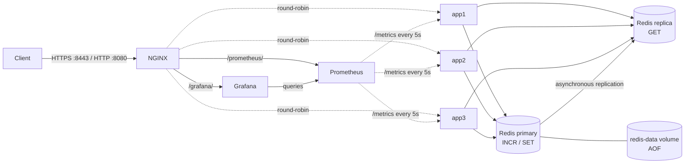

# Architecture

This is the **why** document. The [README](README.md) covers the *what* (what
is this, how do I run it). Here we go deeper: which trade-offs were
considered, which were rejected, and why each choice is the one this codebase
makes.

---

## System at a glance

A reverse-proxy load balancer (NGINX) fronts three identical stateless
backend replicas (Go). All writes go to a persistent Redis primary;
`/get` reads go to its read replica. Prometheus scrapes each backend,
and Grafana provides a provisioned dashboard. These eight services use
Compose's internal network; only NGINX publishes host ports.



The interesting questions are: why three replicas? why one proxy? why Redis
specifically? why not just one fat server? The rest of this document answers
each in turn.

---

## Why three replicas behind a single proxy

The pedagogical goal is to surface the **shared-state coordination problem**
— the moment you have more than one process serving requests, two questions
appear that don't exist with a single server:

1. How does the client reach an available replica without knowing which one?
2. How do replicas coordinate state that all clients should see consistently
   (like a global request counter)?

A reverse proxy solves (1): clients have a stable address; the proxy picks a
replica per request. A shared key-value store solves (2): replicas don't
gossip among themselves. They send writes to the same primary and read
keys from its asynchronously replicated copy.

Three replicas is the minimum useful number for demonstrating distribution
(two replicas would be alternation, not "distribution") and for showing
failover (with three, killing one still leaves a majority running).

---

## Local state vs shared state

The system exposes two counters on `GET /` that look identical to the client
but behave completely differently:

| Counter | Storage | Scope | Behavior |
|---------|---------|-------|----------|
| `local_count` | `atomic.Int64` in the replica's process memory | Per-replica | Each replica counts only the requests it personally handles. |
| `global_count` | Redis key, incremented via `INCR` | Stack-wide | Every replica writes the same key; clients always see a monotonically increasing value. |

Why both? Because they teach opposite lessons.

`local_count` shows what happens when state lives **in process memory**: it's
fast (a single atomic CPU instruction on most architectures), but it's
invisible to the other replicas. app1 can have `local_count = 12` while app2
still has `local_count = 7`, and that's correct — they really did handle
different counts of requests. If your application logic depends on
cross-replica visibility, this is a foot-gun.

`global_count` shows what happens when state lives **in a shared store**:
every increment is a network round-trip (slower), but all backends use
the same atomic counter on the primary. Counter responses come directly
from `INCR`; they do not read the replica.

The rule of thumb is: anything a user can observe via a different request
route (e.g., a session token, a like count, a job status) needs to be in
shared storage; anything internal to a single request can stay local.

---

## Persistent primary and eventual reads

The primary serves `INCR` for `GET /` and `SET` for `/store`. It enables
`appendonly yes` with `appendfsync everysec`; AOF files live at `/data`
on the named `redis-data` volume. Normal restart, primary-container
replacement, and full-stack `docker compose down` followed by `up`
retain that volume. `docker compose down -v` deliberately deletes all
three named volumes, including monitoring history and Grafana login state.
Unidentified existing volumes are never adopted or pruned.

The every-second fsync policy balances disk work against durability.
An orderly shutdown preserves acknowledged writes, but a host crash
can lose approximately one second of recent writes. A named volume is
also not a backup: loss of its underlying storage still loses data.

`redis-replica` follows the primary on `redis:6379`, rejects writes, and
sets `replica-serve-stale-data no`. Its local storage is rebuildable;
the primary's volume is the recovery source. There is no automatic
promotion, Sentinel, or Cluster. Losing the primary therefore still
interrupts writes until it recovers.

Application routing is explicit:

| Configuration / operation | Destination |
|---------------------------|-------------|
| `REDIS_ADDR` (default `localhost:6379`) | Primary for counter `INCR` and `/store` `SET`. |
| `REDIS_READ_ADDR` (default `REDIS_ADDR`) | Reader for `/get` `GET`; Compose selects `redis-replica:6379`. |
| Identical primary and reader addresses | One Redis client, preserving primary-only local operation. |

Both distinct clients receive bounded startup pings. Clients enable
context-deadline handling, and `/get` derives a two-second deadline
from the HTTP request context, preserving an earlier cancellation or
deadline. A stalled reader thus produces the existing JSON `500`
(`{"error":"redis get failed"}`) before NGINX's 15-second read timeout.
NGINX does not retry these `500` responses, and the backend does not
fall back to the primary.

Healthy replication is asynchronous, so successful `/store` does not
guarantee that the next `/get` sees that write. A reader can briefly
return an earlier value, or `200` with `"value":null` for a key not yet
replicated. A disconnected or synchronizing replica rejects reads
instead of serving stale data. Counter increments and `/store` remain
available during a reader outage. Once Redis recovers, existing client
pools reconnect without restarting the backends.

---

## Why Redis `INCR`, not "get-then-set"

The most common bug in counter implementations is read-modify-write:

```go
// WRONG: lost-update race
val, _ := rdb.Get(ctx, "global_count").Int64()
val++
rdb.Set(ctx, "global_count", val, 0)
```

Under concurrency, this loses updates. Imagine app1 and app2 both at the
"get" step at the same moment with `val = 100`:

1. app1 reads 100.
2. app2 reads 100.
3. app1 sets 101.
4. app2 sets 101.

Two requests were served; the counter only advanced by one.

`INCR` avoids this by being atomic on the Redis side — a single command that
the server processes without interleaving:

```go
// RIGHT: atomic
global, _ := rdb.Incr(ctx, "global_count").Result()
```

The stress test in [`app/race_test.go`](app/race_test.go) demonstrates the
distinction empirically. It fires 200 concurrent `GET /` requests using a
"thundering herd" pattern (all goroutines block on a `ready` channel and
release simultaneously). Final assertion: `global_count == 200`. With the
read-modify-write version, this test would consistently produce values in
the 150–195 range — anywhere there's enough concurrency.

This is the bug class most likely to slip past code review, because the
buggy code "works" under light load and only breaks under contention.

---

## NGINX upstream tuning, directive by directive

The config in [`nginx/default.conf`](nginx/default.conf) is intentionally
small. The directives that matter for failover and tracing are below.

```nginx
upstream backend {
    server app1:8080 max_fails=1 fail_timeout=10s;
    server app2:8080 max_fails=1 fail_timeout=10s;
    server app3:8080 max_fails=1 fail_timeout=10s;
}
```

`max_fails=1 fail_timeout=10s` means: if a request to this backend fails
once, NGINX marks it unavailable for 10 seconds and skips it for any
subsequent requests. This is the **outer** failure handling — it prevents
NGINX from repeatedly choosing a known-bad replica.

```nginx
proxy_connect_timeout 2s;
proxy_send_timeout    5s;
proxy_read_timeout    15s;
```

These bound the time NGINX is willing to wait at each stage. `connect = 2s`
is aggressive — TCP setup on a healthy backend is sub-millisecond — so a
dead backend surfaces within seconds rather than minutes. `read = 15s` is
the loose one, because `/slow` is allowed to sleep up to 10 seconds; the
extra 5s is headroom for the response to arrive.

```nginx
proxy_next_upstream error timeout http_502 http_503 http_504;
proxy_next_upstream_tries 3;
```

This is the **inner** failure handling: if the chosen backend fails (for
the reasons listed) during a request, NGINX silently retries the request
on a different backend, up to 3 times total. From the client's point of
view, the failure never happened.

The combination of these two layers is what produces the 100% success rate
in the failover experiment: when app2 is stopped, the first request to it
trips `proxy_next_upstream` (retry on a different replica → success), and
then `max_fails=1` marks app2 unavailable so subsequent requests skip it
entirely.

---

## Why `X-Server-Id` must pass through unchanged

NGINX adds a lot of headers by default (`X-Real-IP`, `X-Forwarded-For`,
etc.) and offers `proxy_set_header` for adding more. It's tempting to
"helpfully" set `X-Server-Id` on the proxy side, but that would be wrong:

- If NGINX sets `X-Server-Id`, the value reflects which **proxy** handled
  the request — useless, since there's only one proxy.
- If both NGINX and the backend set `X-Server-Id`, the client sees two
  values (or one of them gets clobbered, depending on directive order).

The fix is to do nothing on the NGINX side. The backend stamps
`X-Server-Id: appN` in its response, and NGINX forwards the response
headers verbatim by default. The client sees exactly which **backend**
served them — which is the information that actually matters for
observability.

This is the easiest bug to introduce accidentally by adding a "tracing"
header during a refactor.

---

## Why one image with `SERVER_ID` env, not three images

The three replicas run identical code. The only thing that distinguishes
them is the value of `SERVER_ID` (which becomes the `X-Server-Id` response
header). There are two ways to express this:

**Option A (rejected):** Build three Dockerfiles — `Dockerfile.app1`,
`Dockerfile.app2`, `Dockerfile.app3` — each with `ENV SERVER_ID=appN`
baked in. Compose builds three images.

**Option B (chosen):** One `Dockerfile`. Compose builds the image once
via `app1`'s `build:` directive, tags it `multiserver-app:local`. `app2`
and `app3` reference `image: multiserver-app:local` and pass `SERVER_ID`
through the `environment:` block.

Option B is better because:

1. **Build time.** One `go build` per code change, not three. CI is ~3×
   faster.
2. **Image footprint.** One ~34 MB image on disk, not three.
3. **Configuration as data, not artifact.** Replica identity is just an
   env var; you can spin up `app4` without rebuilding anything. This is
   the [12-factor app](https://12factor.net/config) principle of
   externalising config.
4. **Cache hits.** Compose's image cache reuses layers; rebuilding `app1`
   doesn't invalidate `app2` and `app3`'s images.

The plumbing for this is a single line in
[`docker-compose.yml`](docker-compose.yml): `image: multiserver-app:local`
on each of the three app services, and `build: ./app` only on `app1`.

---

## Why multi-stage Docker + non-root user

The [`app/Dockerfile`](app/Dockerfile) has two stages:

```dockerfile
FROM golang:1.26-alpine AS build
# ... compile ...

FROM alpine:3.20 AS runtime
# ... copy binary + minimal runtime deps ...
```

The naive single-stage approach — `FROM golang:1.26 ... go build` — ships
the entire Go toolchain (~350 MB) inside the production image. Compilers,
git, libc-dev, the standard library source code, all of it. None of it
is needed at runtime.

The multi-stage build keeps only the compiled binary in the runtime
image:

- Builder stage: `golang:1.26-alpine` → produces `/out/app`.
- Runtime stage: `alpine:3.20` (~5 MB) + `wget` for the healthcheck +
  the binary. Final image ~34 MB.

That's ~10× smaller, and it eliminates whole categories of CVEs by not
including the compiler in production.

`-trimpath -ldflags="-s -w"` strips absolute file paths and the symbol
table from the binary — saves a few more megabytes and makes the binary
less informative to an attacker who gets shell access.

`CGO_ENABLED=0` builds a statically linked binary so it doesn't need
glibc at runtime — Alpine uses musl libc, so a glibc-linked binary
wouldn't run without extra layers.

**Non-root user** (`USER app` near the end) is defense in depth. If a
handler had a path-traversal bug or a code-injection vulnerability, the
attacker would be a non-privileged user inside an Alpine container — no
ability to write to `/`, no privileged ports, no access to host
filesystems. The container is already a sandbox; the non-root user is
another layer inside it.

---

## TLS termination and graceful shutdown

NGINX accepts HTTPS on host `8443` and HTTP on `8080`, then proxies HTTP
inside Compose's network. Local certificate generation supplies a
self-signed certificate with localhost SANs; a production deployment
needs a trusted certificate rather than clients disabling verification.
Certificates are mounted read-only and private keys remain gitignored.

The Go process traps SIGTERM/Interrupt and drains HTTP requests before
closing its distinct Redis clients. The longest `/slow` request is ten
seconds, the drain allows twelve seconds, and Compose allows fifteen
seconds before forceful termination: `10s < 12s < 15s`. An atomic
in-flight gauge records active work in shutdown logs. Draining one
backend preserves active requests while NGINX can use the others.

---

## Why `depends_on: condition: service_healthy`

Plain `depends_on: [redis]` means "start redis first" — but "start" only
means "the container's main process is running", not "it's serving
requests". A backend that boots and immediately tries `redis.Ping()`
might race with redis's own startup and fail.

`depends_on: redis: condition: service_healthy` means "wait until redis's
healthcheck passes before starting this service". For our stack, the
healthchecks are:

- `redis` → `redis-cli ping` (Redis is accepting commands).
- `redis-replica` → role is replica, primary link is up, and initial
  synchronization has finished. It starts after a healthy primary;
  backends wait for both Redis services.
- `app1` / `app2` / `app3` → an authenticated `wget --spider /health`
  request (the HTTP server is responding).
- `prometheus` → its internal `/-/healthy` endpoint responds; startup waits
  for all three backends.
- `grafana` → its internal `/grafana/api/health` endpoint responds; startup
  waits for Prometheus.
- `nginx` → an authenticated HTTP `/health` request through the proxy succeeds.

NGINX waits for all three apps and both monitoring services to be healthy,
then starts itself. The `docker compose up -d --wait --wait-timeout 90`
command used in CI additionally waits for all eight services to report
healthy. Earlier Redis acceptance timing is retained as historical evidence;
first-run monitoring image downloads also depend on the network.

These are startup gates, not ongoing dependency restarts. `/health`
remains a process-liveness check and does not ping Redis. A later Redis
outage is handled by request errors and client reconnection; it does
not require restarting the backend containers.

---

## Failover math: why 100%, not 90%

Setup: app2 is stopped. A request arrives at NGINX.

**Case A** — round-robin picks app1 or app3:
- Connect succeeds, response comes back. Client sees 200. No retry
  needed.

**Case B** — round-robin picks app2 (the dead one):
- TCP connect to app2:8080 → connection refused immediately (kernel
  rejects, no timeout needed).
- NGINX sees `error` upstream condition, which is on our
  `proxy_next_upstream` list.
- NGINX retries the request on the next replica (app1 or app3).
- Connect succeeds, response comes back. Client sees 200, perhaps a
  few milliseconds later than Case A.

Either way: 200 OK.

Once `max_fails=1 fail_timeout=10s` fires (after the first failure),
app2 is removed from the rotation for 10 seconds. So **only the first
request in any 10-second window pays the retry cost** — everything
after just goes round-robin between app1 and app3.

Worst case for the 20-request experiment: the very first request hits
app2, retries, succeeds. The remaining 19 don't touch app2 at all.
Observed: 20/20 success.

The only way to drop below 90% would be a more permissive fail interval
(e.g., `max_fails=5 fail_timeout=60s` would let 5 failures slip through
in each cycle), or a backend that fails *during* the response rather
than at connect time (harder for NGINX to retry mid-stream).

---

## Per-replica metrics and a provisioned dashboard

The backend exposes `/metrics` through `client_golang`, with an independent
registry per `Server`. `AUTH_TOKEN` protects it just like the other backend
endpoints. The metrics middleware wraps authentication, so rejected requests
are measured as `401`; response-header middleware still supplies request and
backend identity. A successful scrape sets the negotiated Prometheus
exposition content type instead of the JSON API default.

`multiserver_http_requests_total` and the
`multiserver_http_request_duration_seconds` histogram label completed requests
by `server_id`, `route`, and `status`. The route label has seven possible
values: `/`, `/health`, `/store`, `/get`, `/slow`, `/metrics`, and `unmatched`.
Query strings, Redis keys, arbitrary unmatched paths, request IDs, and tokens
are excluded to keep the number of series bounded. The duration histogram
covers ordinary fast handlers and the allowed ten-second `/slow` path.

`multiserver_local_count` reads the existing atomic process counter, and
`multiserver_in_flight_requests` reads the active-request gauge. The latter
includes the current `/metrics` request, so an otherwise idle replica commonly
reports one. Metrics scrapes can appear in HTTP request metrics but never
increment either business counter.

The shared counter collector performs a primary `GET global_count` with a
500ms deadline. It does not issue `INCR` or read the replica. An absent key
means zero; a primary read failure omits `multiserver_global_count` and emits
`multiserver_global_count_scrape_success 0`. Successful reads emit the value
and success `1`. This distinguishes an unavailable dependency from a reset
counter while bounding scrape latency. The dashboard uses
`max(multiserver_global_count)` across replicas: all three observe one Redis
key, so summing them would triple the result. Scrapes are separate observations
and can differ briefly as traffic arrives.

Prometheus 3.15.1 scrapes all three internal `appN:8080/metrics` targets every
five seconds, independently of NGINX's round-robin pool. On container startup,
the configured `AUTH_TOKEN` is written with restrictive permissions to
`/tmp/auth_token`; `authorization.credentials_file` reads that generated file.
An empty token preserves unauthenticated local operation. No credential file
is committed. The `prometheus-data` named volume holds time series, with a
seven-day retention limit.

Grafana 13.3.0 provisions the datasource UID `prometheus` at
`http://prometheus:9090` and dashboard UID `multiserver` from files in
[`monitoring/`](monitoring/). The dashboard defaults to the last fifteen
minutes with five-second refreshes. It shows request rates per replica,
p50/p95/p99 from histogram buckets, backend `4xx`/`5xx` error percentage,
shared/local counters, active requests, and scrape health. Application panels
exclude `/health` and `/metrics`. NGINX rejects `429` requests before backend
instrumentation, so those responses are not included in these metrics.

NGINX routes `/grafana/` and `/prometheus/` over its existing host ports;
monitoring services publish no additional ports. The default dashboard URL is
`https://localhost:8443/grafana/d/multiserver`, and the Prometheus UI/API is at
`https://localhost:8443/prometheus/`. `GRAFANA_ROOT_URL` sets Grafana's canonical
public URL. The local login is `admin` / `local-grafana-admin`; set
`GRAFANA_ADMIN_PASSWORD` before first startup. Grafana stores the initialized
account in the `grafana-data` database volume, so changing the environment
variable later does not reset an existing password. Ordinary teardown retains
both monitoring volumes.

Backend bearer authentication does not guard the monitoring UIs. Grafana has
its own login, and the Prometheus UI/API has no authentication in this local
configuration. External access would require an appropriate access policy.
Configuration stays reproducible through version-controlled provisioning;
changes to the provisioned dashboard should be made in its JSON source.

---

## Tracing without OpenTelemetry

Distributed tracing usually implies OTLP, Jaeger, a sampling story, a
backend storage system, dashboards. For this small stack you don't
need any of that — just a per-request id that propagates.

NGINX has `$request_id` built in (a 32-char hex string per request). We
set it as a request header before proxying:

```nginx
proxy_set_header X-Request-Id $request_id;
```

The backend's middleware reads `X-Request-Id` from the incoming request,
logs it (structured JSON via `log/slog`), and stamps it on the response
header:

```go
w.Header().Set("X-Request-Id", requestID)
```

A client running `curl -i` sees:

```
X-Request-Id: a1b2c3...
```

A developer reading `docker compose logs app1` sees:

```json
{"msg":"request","request_id":"a1b2c3...","method":"GET","path":"/"}
```

Same id in both places. You can correlate a client-visible error with the
exact log line that produced it, without any external infrastructure.

If we ever need real tracing, the backend already logs `request_id` — a
collector that scrapes the JSON logs is a one-day project.

---

## Testing strategy: four tiers, each with a job

The codebase has four levels of test, deliberately separated by what
they're checking:

| Tier | Question it answers | Failure means |
|------|---------------------|---------------|
| `cd app && go test ./...` (unit) | Are handlers, reader routing, errors, cancellation, and deadlines correct? | Application logic regression. |
| `cd app && go test -race ./...` (stress) | Is concurrent access to counters race-free? | Counter implementation isn't atomic — lost updates under contention. |
| `./scripts/test.sh` (smoke) | Does the full stack expose every endpoint correctly through NGINX? | Integration regression — Compose, NGINX config, or backend wiring is broken. |
| `./scripts/test-redis.sh` (recovery) | Do real Redis replication, deadlines, persistence, and reconnection work? | Redis configuration, routing, or recovery regression. |
| `./scripts/test-security.sh` (security) | Do optional authentication, NGINX bursts, and rate-limit recovery work without rejected-request mutations? | Authentication or proxy-policy regression. |
| `python3 scripts/test-metrics.py` (monitoring) | Are all three scrapes healthy, counters unchanged by scrapes, and dashboard queries valid? | Instrumentation, credentials, provisioning, or query regression. |
| `./scripts/experiments.sh` (evidence) | Does the stack exhibit the documented behaviors? | Captures behavior, including the Redis recovery gate as Experiment 6. |

These remain four tiers: unit logic, concurrency, integration, and
behavior experiments. Two independent miniredis instances prove
application routing without pretending to implement replication.
Real Redis checks cover the behavior that a fake cannot prove.

CI runs `go vet`, race tests, image build, HTTPS smoke, focused Redis
recovery, security, and metrics/dashboard checks on pushes to `main` and
pull requests. Authentication-disabled and authentication-enabled runs
exercise the optional credential path. Failure
diagnostics include service states and recent logs; teardown always
runs and retains named storage. Full behavior capture is local-only.

Smoke fixtures use unique keys and values, and read-after-write checks
poll for the exact expected value rather than assuming immediate
consistency. The API-only smoke suite retains one small `smoke-*` key
per run because there is no delete endpoint. Recovery and experiment
scripts remove only their own keys; they never flush Redis or remove
volumes.

The recovery script interrupts Redis and requires no other application
traffic. Its 15 checks cover core-service readiness, persistence settings,
replica read-only enforcement, updated values through all three
backends, stopped/paused readers, and primary restart/replacement.
Persistence assertions inspect the primary directly so the replica
cannot hide lost storage. Backend container IDs and start times must
remain unchanged. Recovery polling is bounded, and cleanup restores
interrupted services even after a failure.

The captured [Experiment 6](report/screenshots/exp6_redis_persistence.txt)
passed all 15 checks: a stopped reader returned JSON `500` in 1.82 seconds
and a paused reader in 2.01 seconds. Direct primary checks confirmed
counter continuity `176 → 177` after restart and `177 → 178` after
container replacement. The [acceptance evidence](report/screenshots/issue6_acceptance.txt)
records full-stack persistence, graceful shutdown, startup timing, and
regression checks.

The earlier six-service Redis acceptance run completed a cached-image
build and full-stack startup in 20 seconds. Ordinary teardown/startup retained the primary marker
and counter (`210 → 211` on the next increment). With the read address
empty, direct reads still succeeded while the replica was paused. A
direct ten-second `/slow` request completed with HTTP `200` during
SIGTERM; logs recorded one in-flight request and successful draining.

Keeping them separate matters: a smoke-test failure has a different
investigation path (check Compose, check NGINX config) than a unit-test
failure (look at the handler in question), and conflating them slows
debugging.

---

## Deliberate limitations

- **One write primary, no automatic promotion.** The read replica adds
  read capacity and demonstrates replication; it does not make writes
  highly available. Sentinel/Cluster and sharding remain future work.
- **Eventual reads and bounded durability.** There is no read-your-write
  guarantee across the replica, and AOF `everysec` has a crash-loss
  window. Backups and off-host storage are not configured.
- **Local TLS material.** Self-signed development certificates require
  a trusted replacement for production, with certificate renewal.
- **Shared-token access control.** Optional bearer authentication protects
  every backend endpoint, including health probes. All replicas share one
  token; there is no user identity, role model, or managed token rotation.
  NGINX limits only `/` to 10 requests/second per connection client IP,
  burst 20, with immediate overflow rejection as JSON `429`. Other routes
  remain unthrottled. Forwarded headers cannot select the rate-limit key.

- **Local monitoring.** Prometheus and Grafana each run as a single instance
  with local named-volume storage. Prometheus keeps seven days; off-host
  backups, remote storage, alert delivery, and a shared monitoring access
  policy are not configured.
