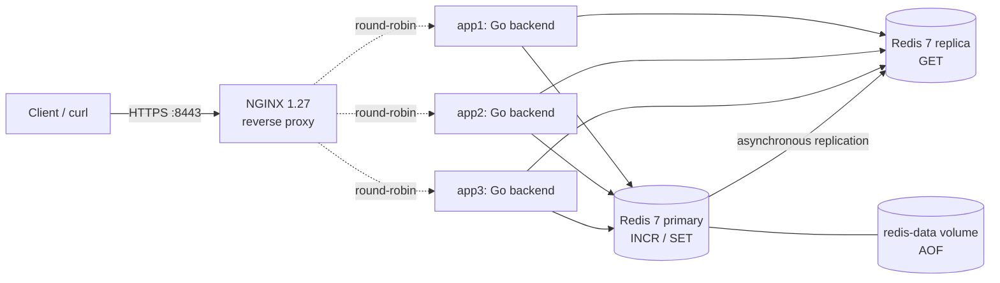

# Docker-based Multiserver System

> An NGINX reverse proxy fronting three identical Go backends, backed by a persistent
> Redis primary and a read replica. Orchestrated by Docker Compose.

[](https://github.com/kajuyerim/docker-based-multiserver-system/actions/workflows/ci.yml)

---

## Quick start

```bash
./scripts/gen-cert.sh                              # generate local self-signed TLS material
docker compose up --build -d --wait --wait-timeout 90 # wait for all six services
curl -ki https://localhost:8443/health             # HTTPS smoke check
./scripts/test.sh                                  # full end-to-end smoke over HTTPS
./scripts/test-redis.sh                            # disruptive Redis recovery checks
docker compose down                               # stop containers; retain stored data
```

Cached-image build and startup completed in **20 seconds** in the [acceptance run](report/screenshots/issue6_acceptance.txt), within the 90-second budget. First-run image downloads depend on the network. Once up:

| URL | What it does |
|-----|--------------|
| `https://localhost:8443/` | Increment local + global counters |
| `https://localhost:8443/store?key=K&value=V` | Write to the Redis primary |
| `https://localhost:8443/get?key=K` | Read from the replica (eventually consistent; absent key returns `"value":null`) |
| `https://localhost:8443/slow?seconds=N` | Sleep N seconds (silently clamped to 10) |
| `https://localhost:8443/health` | Liveness probe (no counter side-effects) |

---

## Architecture



Six services, orchestrated by a single `docker-compose.yml`:

| Service | Image | Role |
|---------|-------|------|
| `nginx` | `nginx:1.27-alpine` | TLS terminator and reverse proxy on host `:8443` (HTTPS) and `:8080` (HTTP). **The only service that publishes host ports.** Round-robin LB with fast failover (see [`nginx/default.conf`](nginx/default.conf)). |
| `app1`, `app2`, `app3` | `multiserver-app:local` (built once from [`app/`](app/)) | Three identical Go backend replicas. Differ only by the `SERVER_ID` env var, which they stamp on every response as `X-Server-Id`. |
| `redis` | `redis:7-alpine` | Primary for counter `INCR` and `/store` writes; AOF stored in the named `redis-data` volume. |
| `redis-replica` | `redis:7-alpine` | Read-only replica serving `/get`; rejects reads while disconnected or synchronizing. |

Healthchecks gate startup: the primary accepts commands, then the replica connects and finishes synchronization, then the three backends pass `/health`, and finally NGINX starts. The health endpoint is a liveness probe; it does not check Redis on each request.

### Redis routing and durability

`REDIS_ADDR` selects the primary (default `localhost:6379`). Optional `REDIS_READ_ADDR` defaults to the same address; Compose sets it to `redis-replica:6379`. Identical addresses reuse one client. Only `/get` uses the reader; `/store` and counter `INCR` always use the primary. Startup checks both configured clients, and clients reconnect after Redis recovery without restarting the backends.

Replication is asynchronous. Immediately after `/store` succeeds, `/get` may briefly return an earlier value or `"value":null`. Each Redis `GET` has a two-second context budget. Reader errors return JSON `500` (`{"error":"redis get failed"}`), with no fallback to the primary. A replica outage leaves primary writes and counter increments available.

The primary enables AOF with `appendfsync everysec`. Ordinary restarts, container replacement, and `docker compose down` followed by `up` preserve data in `redis-data`. A host crash can lose approximately one second of writes; this is not a zero-loss guarantee. **`docker compose down -v` deletes persistent storage.** Replica storage is rebuildable from the primary, and automatic promotion/Sentinel is not configured.

### TLS

[`scripts/gen-cert.sh`](scripts/gen-cert.sh) creates a 365-day self-signed RSA certificate for local development, with subject alternative names for `localhost`, `127.0.0.1`, and `::1`. The certificate and private key live under the gitignored `nginx/certs/` directory and are mounted read-only into NGINX.

NGINX terminates TLS on container port `443`, published as host port `8443`, then proxies ordinary HTTP across Compose's private network to the backends. Plain HTTP remains available on `:8080` for compatibility. Because the development certificate is self-signed, local clients use `curl -k`; a production deployment would supply a certificate from a trusted CA and would not disable verification. The smoke suite defaults to HTTPS and can still exercise HTTP with `BASE_URL=http://localhost:8080 ./scripts/test.sh`.

### Local vs shared state

- **`local_count`** is per-replica state — an in-process `atomic.Int64`. Replicas don't see each other's local counters, so `app1`'s `local_count` can be 12 while `app2`'s is 7 at the same moment.
- **`global_count`** is shared state — a Redis key incremented via atomic `INCR`. Every replica writes the same key; clients always see a monotonically rising value regardless of which replica handled the request.

### Tracing

NGINX generates a per-request `X-Request-Id` from `$request_id` and forwards it to the backend. The backend reads it, logs it (structured JSON via `log/slog`), and stamps it on the response. End-to-end tracing without external tooling.

---

## API reference

| Method | Path | Query params | Response body | Notes |
|--------|------|--------------|---------------|-------|
| `GET` | `/health` | — | `{"status":"ok","server_id":"appN"}` | Liveness; counters untouched |
| `GET` | `/` | — | `{"server_id":"appN","local_count":L,"global_count":G}` | **Only** endpoint that increments counters |
| `GET` | `/store` | `key`, `value` (both required) | `{"stored":true,"key":...,"value":...,"server_id":...}` | Primary write; `400` if either is missing |
| `GET` | `/get` | `key` (required) | `{"server_id":...,"key":...,"value":...\|null}` | Replica read; missing key → `200` with `"value":null`; reader failure → JSON `500` |
| `GET` | `/slow` | `seconds` (int, required) | `{"server_id":"appN","slept":N}` | `seconds` is silently clamped to `[0, 10]`; `400` if missing or non-numeric |

Every response carries:

- `Content-Type: application/json`
- `X-Server-Id: appN` — which replica handled it (stamped by backend; NGINX passes it through unchanged)
- `X-Request-Id: <hex>` — generated by NGINX, echoed by the backend

---

## Pitfalls — and how this implementation avoids them

| Pitfall | Implementation choice |
|---------|----------------------|
| Lost counter updates under concurrency | `global_count` uses Redis `INCR` (single atomic round-trip). The stress test in [`app/race_test.go`](app/race_test.go) fires 200 concurrent `GET /` requests and asserts the final counter equals 200. |
| NGINX rewriting `X-Server-Id` | NGINX config has **no** `add_header` or `proxy_set_header X-Server-Id` directive. Backend stamps it; NGINX forwards unchanged. |
| Missing `Content-Type` | Middleware sets `Content-Type: application/json` on the response writer before any handler writes status or body. |
| Backend port leakage | Only `nginx` declares `ports:` (`8080:80` and `8443:443`). All other services live on Compose's internal network. |
| Counter increments on the wrong endpoints | Only `GET /` mutates counters. `/health`, `/store`, `/get`, `/slow` are counter-free. |
| Three near-identical Docker images | One `build:` directive on `app1`; `app2` and `app3` reference `image: multiserver-app:local`. **One image, three replicas.** |
| Slow startup | Multi-stage Docker build (Go 1.26-alpine builder → Alpine 3.20 runtime, ~30 MB). Healthcheck-gated dependencies; startup timing is recorded in the acceptance evidence. |
| Backend failure breaking client requests | NGINX `proxy_next_upstream error timeout http_502 http_503 http_504; proxy_next_upstream_tries 3` transparently retries on the next replica. Empirically: 20 of 20 requests succeed with one backend stopped. |

---

## Testing

| Tier | Command | What it does |
|------|---------|--------------|
| Unit + race detector | `cd app && go test -race -v ./...` | `httptest` + [`miniredis/v2`](https://github.com/alicebob/miniredis) cover handlers, separate primary/reader routing, lag, errors, cancellation, and deadlines. Includes a 200-concurrent counter stress test. |
| End-to-end smoke | `./scripts/test.sh` (stack up) | Exercises every endpoint through NGINX over HTTPS, with unique fixtures and bounded polling for replication. |
| Redis recovery | `./scripts/test-redis.sh` (stack up, no other traffic) | 15 checks cover configuration, replication through every backend, stopped/paused readers, persistent primary restart/replacement, and recovery without backend restarts. |
| Experiments | `./scripts/experiments.sh` (stack up, no other traffic) | Captures the five original behavior experiments plus Redis recovery as Experiment 6; Redis-check failures propagate through output capture. |
| CI | Push to `main` or open a PR | Runs `go vet`, race tests, image build, HTTPS smoke, and Redis recovery checks; teardown runs even after failure. |

The smoke suite uses only HTTP(S) API calls and retains one small, unique `smoke-*` fixture per run because the API has no delete endpoint. Redis recovery and experiment scripts remove their own test keys and restore interrupted services; they never flush Redis or delete volumes.

Recorded [Experiment 6](report/screenshots/exp6_redis_persistence.txt) passed all 15 checks. Reads returned JSON `500` in 1.82 seconds with the replica stopped and 2.01 seconds with it paused. The primary counter continued `176 → 177` after restart and `177 → 178` after replacement; backend IDs and start times stayed unchanged. [Final acceptance](report/screenshots/issue6_acceptance.txt) also verified primary-only configuration, data surviving full-stack teardown/startup, and a direct ten-second request completing during SIGTERM.

---

## Repository layout

```
.
├── app/                       Go backend service
│   ├── main.go                env wiring, Redis client init, server bootstrap
│   ├── server.go              Server struct, handlers, middleware, typed response structs
│   ├── server_test.go         handler and middleware tests (miniredis-backed)
│   ├── redis_routing_test.go  reader routing, errors, cancellation, deadlines
│   ├── race_test.go           200-concurrent stress test for counter atomicity
│   ├── Dockerfile             multi-stage, alpine runtime, non-root user
│   ├── go.mod, go.sum
│   └── .dockerignore
├── nginx/
│   ├── default.conf           TLS termination, upstream pool, failover, request-id
│   └── certs/                 generated local certificate + key (gitignored)
├── scripts/
│   ├── gen-cert.sh            generates self-signed localhost TLS material
│   ├── test.sh                end-to-end smoke (used by CI)
│   ├── test-redis.sh          Redis replication, interruption, persistence checks
│   └── experiments.sh         captures behavior experiments to text files
├── .github/workflows/ci.yml   CI pipeline
└── docker-compose.yml         stack definition (6 services + redis-data volume)
```

---

## Tech stack

- **Backend:** Go (stdlib `net/http`), [`go-redis/v9`](https://github.com/redis/go-redis), `log/slog` for structured JSON logs
- **Proxy:** [NGINX](https://nginx.org) 1.27 (alpine)
- **Store:** [Redis](https://redis.io) 7 (alpine), AOF primary + asynchronous read replica
- **Runtime image:** Alpine 3.20, non-root `app` user, ~30 MB
- **Orchestration:** Docker Compose (single `docker-compose.yml`, no overrides)
- **Tests:** Go's `testing` + [`miniredis/v2`](https://github.com/alicebob/miniredis); pure bash for the smoke / experiment scripts
- **CI:** GitHub Actions

---

## Authors

Built by **Kerem Haktan Kurt** and **Kerem Bozkurt** as a university course project at Boğaziçi University.

## License

No license claimed.
