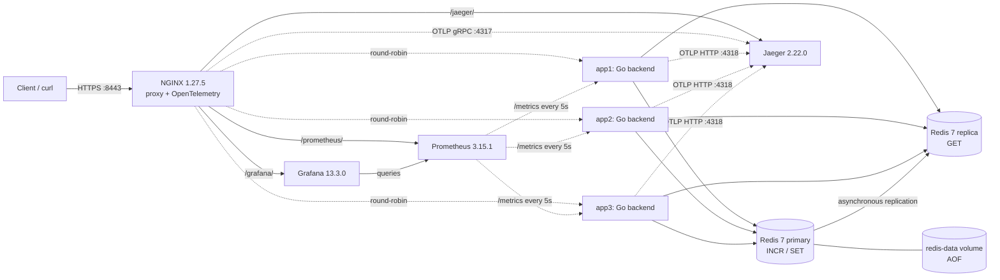
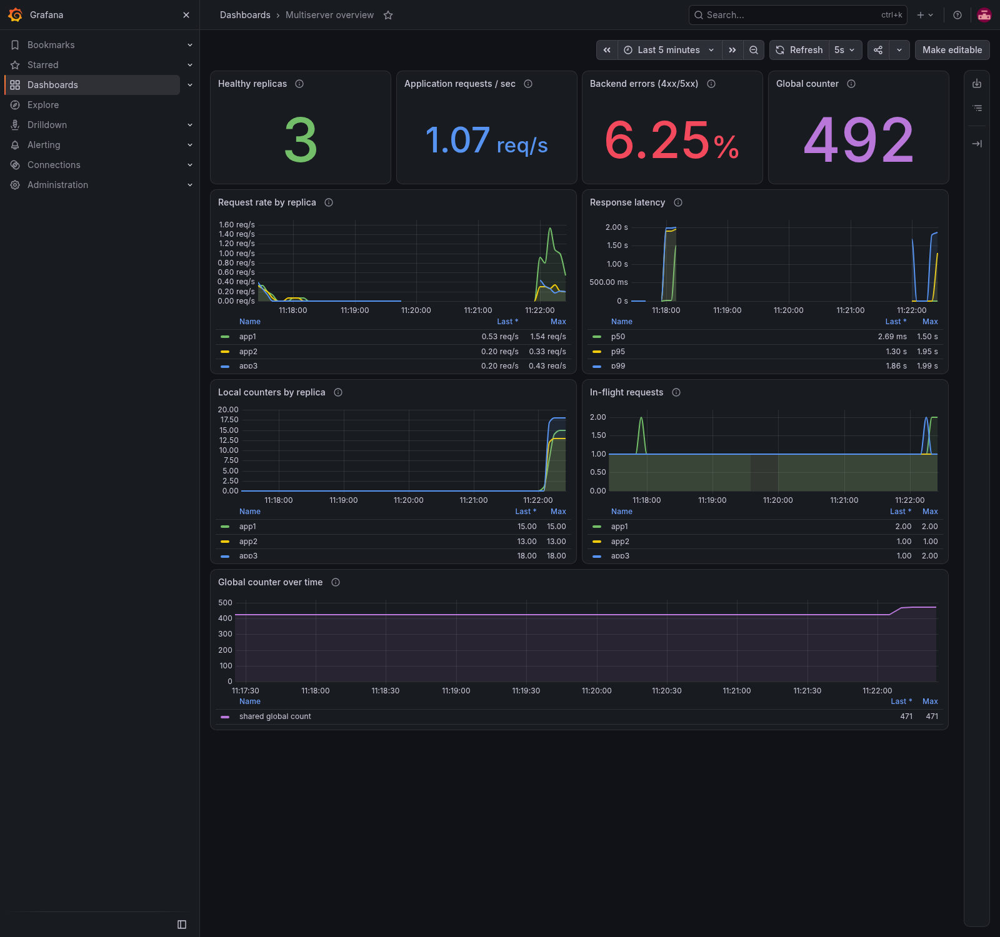
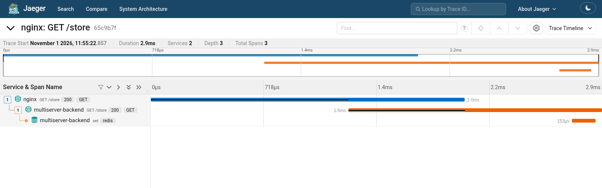

# Docker-based Multiserver System

> An NGINX reverse proxy fronting three identical Go backends, backed by a persistent
> Redis primary and a read replica, with Prometheus metrics and a provisioned Grafana
> dashboard, plus OpenTelemetry traces in Jaeger. Orchestrated by Docker Compose.

[](https://github.com/kajuyerim/docker-based-multiserver-system/actions/workflows/ci.yml)

---

## Quick start

```bash
./scripts/gen-cert.sh                              # generate local self-signed TLS material
docker compose up --build -d --wait --wait-timeout 90 # wait for all nine services
curl -ki https://localhost:8443/health             # HTTPS smoke check
./scripts/test.sh                                  # full end-to-end smoke over HTTPS
python3 scripts/test-metrics.py                    # scrape and dashboard integration checks
python3 scripts/test-tracing.py                    # NGINX -> Go -> Redis trace verification
./scripts/test-redis.sh                            # disruptive Redis recovery checks
docker compose down                               # stop containers; retain stored data
```

The nine-service tracing [acceptance run](report/screenshots/issue2_acceptance.txt) measured a **24.93-second** cached-image build/startup, within the 90-second budget. First-run image downloads depend on the network. Once up:

| URL | What it does |
|-----|--------------|
| `https://localhost:8443/` | Increment local + global counters |
| `https://localhost:8443/store?key=K&value=V` | Write to the Redis primary |
| `https://localhost:8443/get?key=K` | Read from the replica (eventually consistent; absent key returns `"value":null`) |
| `https://localhost:8443/slow?seconds=N` | Sleep N seconds (silently clamped to 10) |
| `https://localhost:8443/health` | Liveness probe (no counter side-effects) |
| `https://localhost:8443/metrics` | Prometheus exposition from the selected backend; honors `AUTH_TOKEN` |
| [Grafana](https://localhost:8443/grafana/) | Dashboard UI; local login `admin` / `local-grafana-admin` |
| [Prometheus](https://localhost:8443/prometheus/) | Scrape targets, metric queries, and stored time series |
| [Jaeger](https://localhost:8443/jaeger/) | NGINX → Go → Redis traces and timing |

---

## Architecture



Nine default services, orchestrated by a single `docker-compose.yml`. Screenshot rendering and load generation use optional profiles:

| Service | Image | Role |
|---------|-------|------|
| `nginx` | `nginx:1.27.5-alpine-otel` | TLS terminator and reverse proxy on host `:8443` (HTTPS) and `:8080` (HTTP). **The only service that publishes host ports.** Round-robin LB with fast failover (see [`nginx/default.conf`](nginx/default.conf)). |
| `app1`, `app2`, `app3` | `multiserver-app:local` (built once from [`app/`](app/)) | Three identical Go backend replicas. Differ only by the `SERVER_ID` env var, which they stamp on every response as `X-Server-Id`. |
| `redis` | `redis:7-alpine` | Primary for counter `INCR` and `/store` writes; AOF stored in the named `redis-data` volume. |
| `redis-replica` | `redis:7-alpine` | Read-only replica serving `/get`; rejects reads while disconnected or synchronizing. |
| `prometheus` | `prom/prometheus:v3.15.1` | Scrapes all three backends internally every 5 seconds; retains 7 days in `prometheus-data`. |
| `grafana` | `grafana/grafana:13.3.0` | Provisioned Prometheus datasource and Multiserver overview dashboard; configuration and login database persist in `grafana-data`. |
| `jaeger` | `jaegertracing/jaeger:2.22.0` | OTLP collector and trace UI with an in-memory limit of 10,000 traces; no persistent trace volume. |

Healthchecks gate startup: backends wait for a healthy primary, a synchronized replica, and Jaeger. Prometheus waits for the three backends, Grafana waits for Prometheus, and NGINX waits for the apps and monitoring services. The backend health endpoint is a liveness probe; it does not check Redis on each request.

### Redis routing and durability

`REDIS_ADDR` selects the primary (default `localhost:6379`). Optional `REDIS_READ_ADDR` defaults to the same address; Compose sets it to `redis-replica:6379`. Identical addresses reuse one client. Only `/get` uses the reader; `/store` and counter `INCR` always use the primary. Startup checks both configured clients, and clients reconnect after Redis recovery without restarting the backends.

Replication is asynchronous. Immediately after `/store` succeeds, `/get` may briefly return an earlier value or `"value":null`. Each Redis `GET` has a two-second context budget. Reader errors return JSON `500` (`{"error":"redis get failed"}`), with no fallback to the primary. A replica outage leaves primary writes and counter increments available.

The primary enables AOF with `appendfsync everysec`. Ordinary restarts, container replacement, and `docker compose down` followed by `up` preserve data in `redis-data`. A host crash can lose approximately one second of writes; this is not a zero-loss guarantee. **`docker compose down -v` deletes every named volume: Redis data, Prometheus history, and Grafana configuration/login state.** Replica storage is rebuildable from the primary, and automatic promotion/Sentinel is not configured.

### TLS

[`scripts/gen-cert.sh`](scripts/gen-cert.sh) creates a 365-day self-signed RSA certificate for local development, with subject alternative names for `localhost`, `127.0.0.1`, and `::1`. The certificate and private key live under the gitignored `nginx/certs/` directory and are mounted read-only into NGINX.

NGINX terminates TLS on container port `443`, published as host port `8443`, then proxies ordinary HTTP across Compose's private network to the backends. Plain HTTP remains available on `:8080` for compatibility. Because the development certificate is self-signed, local clients use `curl -k`; a production deployment would supply a certificate from a trusted CA and would not disable verification. The smoke suite defaults to HTTPS and can still exercise HTTP with `BASE_URL=http://localhost:8080 ./scripts/test.sh`.

### Local vs shared state

- **`local_count`** is per-replica state — an in-process `atomic.Int64`. Replicas don't see each other's local counters, so `app1`'s `local_count` can be 12 while `app2`'s is 7 at the same moment.
- **`global_count`** is shared state — a Redis key incremented via atomic `INCR`. Every replica writes the same key; clients always see a monotonically rising value regardless of which replica handled the request.

## Security

NGINX limits `/` (including query-string variants) to **10 requests per second per client IP**, with a burst of 20 excess requests served immediately. Overflow returns JSON `429` with `Retry-After: 1` and a request ID. Other paths do not consume that bucket. The key uses the connection's client address, not an untrusted forwarded header; clients behind the same NAT share the limit. See the [NGINX rate-limit module](https://nginx.org/en/docs/http/ngx_http_limit_req_module.html).

Authentication is optional and disabled when `AUTH_TOKEN` is unset or empty. To enable it, export a strong random token in your shell and recreate the services:

```bash
export AUTH_TOKEN="$(openssl rand -hex 32)"
docker compose up -d --wait --wait-timeout 90
printf 'Authorization: Bearer %s\n' "$AUTH_TOKEN" | curl -k --header @- https://localhost:8443/health
./scripts/test-security.sh
./scripts/test.sh
```

Every backend endpoint, including `/health` and unknown paths, requires a bearer token when enabled. Missing or invalid credentials return JSON `401` and `WWW-Authenticate: Bearer`, without performing endpoint work. Container healthchecks and integration runners supply the configured token; application logs never include it. All three replicas use the same token. To disable authentication, unset `AUTH_TOKEN` and recreate the services again.

Use HTTPS when sending credentials. The HTTP port remains enabled for local compatibility, so this configuration alone is not a public deployment policy. Environment configuration is visible to administrators with Docker access; keep tokens out of committed files and captured logs. Rate limiting applies only to the counter endpoint, and this shared-token guard provides no per-user permissions or token rotation service.

## Metrics and dashboard

Open the [Multiserver overview dashboard](https://localhost:8443/grafana/d/multiserver) after startup. Before the first start, set `GRAFANA_ADMIN_PASSWORD` to replace the local demo password. Grafana creates its `admin` account in the persistent database on first startup; changing the environment variable later does not reset an existing password. `GRAFANA_ROOT_URL` defaults to `https://localhost:8443/grafana/` and can be set for a different public URL.



The optional `render` Compose profile runs Grafana's official image renderer to export screenshots; it adds no public port and is outside normal startup. Start it with `docker compose --profile render up -d renderer`, then use Grafana's export action. `RENDERER_AUTH_TOKEN` configures the shared renderer credential (local default `local-renderer-only`); use a private value outside the local demonstration. The renderer callback stays on the internal HTTP network.

Prometheus scrapes `app1:8080`, `app2:8080`, and `app3:8080` directly, so every replica is observed independently. Its bearer credential file is generated from `AUTH_TOKEN` inside the container at `/tmp/auth_token`; no token file is committed. Successful `/metrics` responses use the negotiated Prometheus exposition format, an intentional exception to the JSON API. Rejected authentication still returns JSON `401`.

| Metric | Meaning |
|--------|---------|
| `multiserver_http_requests_total` | Completed requests with `server_id`, bounded `route`, and HTTP `status` labels, including authentication `401`. |
| `multiserver_http_request_duration_seconds` | Duration histogram with the same labels; the dashboard derives p50/p95/p99. |
| `multiserver_in_flight_requests` | Active requests per replica, including the current scrape; an idle scrape typically reports one. |
| `multiserver_local_count` | Process-local root counter, which resets on backend restart. |
| `multiserver_global_count` | Shared counter read directly from the Redis primary with a 500ms budget. |
| `multiserver_global_count_scrape_success` | `1` when that primary read succeeds, `0` when it fails; failed reads omit the global-count sample rather than reporting a false zero. |

Routes are `/`, `/health`, `/store`, `/get`, `/slow`, `/metrics`, or `unmatched`; keys, query strings, request IDs, and tokens never become labels. Scrapes perform `GET`, never `INCR`, and do not change either business counter. Dashboard rates, latency, and error percentages exclude `/health` and `/metrics`; errors include backend `4xx` and `5xx`. NGINX `429` responses do not reach a backend and therefore are absent from these application metrics. The global-counter panel uses **`max`**, because summing three observations of the same Redis key would triple the value.

The [Prometheus UI/API](https://localhost:8443/prometheus/) has no bearer-token guard. Grafana uses its own login and is independent of `AUTH_TOKEN`; enabling the backend token does not protect either monitoring UI. Both services stay on the internal network and are reached through NGINX's existing ports. Prometheus retains seven days of local history; ordinary `down` preserves both monitoring volumes. This is local demonstration storage, without external backups or alert delivery. The [provisioning files](monitoring/) are version controlled; dashboard edits belong in the JSON source.

## Distributed tracing and request correlation

Open [Jaeger](https://localhost:8443/jaeger/) and select `multiserver-backend` to inspect an API request. NGINX's native OpenTelemetry module creates the proxy span, Go's `otelhttp` creates its child HTTP span, and `redisotel` records child `GET`, `SET`, or `INCR` spans. The backend resource identifies `service.name=multiserver-backend` and `service.instance.id=app1|app2|app3`; the proxy resource is `service.name=nginx`.



W3C `traceparent` context propagates across the proxy and backend, preserving a valid client's trace ID. NGINX adds `X-Trace-Id` to traced API responses. Existing `X-Request-Id` headers and structured request logs remain available; the same ID appears as `request.id` on proxy, backend HTTP, and Redis spans. The [representative trace JSON](report/screenshots/trace_sample.json) shows the parent relationships without storing fixture keys or values.

NGINX exports OTLP/gRPC to Jaeger on internal port `4317`. Each backend exports OTLP/HTTP using `OTEL_EXPORTER_OTLP_ENDPOINT=http://jaeger:4318`, which sends spans to `/v1/traces`. Compose enables it on all three backends. For standalone local execution, leaving the variable unset or empty disables the Go SDK/exporter. Go uses parent-based sampling with new root requests sampled by default. Health probes, metrics scrapes, monitoring UI traffic, Redis startup/negotiation, and background counter collection are excluded from traces.

NGINX resolves backend and monitoring UI addresses through Docker DNS every five seconds. A loopback-only gRPC relay forwards native trace exports through the same address refresh, so each exporter worker can keep a stable local connection when Jaeger's container address changes. The relay adds no published port or extra service.

Backend spans use bounded HTTP routes and omit query strings, authorization headers, Redis keys/values, and database statements. The native NGINX exporter can include query text in its default `http.target` attribute before collection; Jaeger's collector removes `http.target`, `url.full`, `url.query`, `db.statement`, and `db.query.text` **before storage**. Those transport paths remain inside Compose's network.

Trace export runs in the background, so a collector outage does not fail API requests; delivery can be lost during an outage. Shutdown drains HTTP work for up to twelve seconds, then allows up to two seconds to flush the SDK before Compose's fifteen-second grace period. Jaeger keeps at most **10,000 traces in memory**, not a fixed byte budget; a Jaeger restart discards them. Its UI/API has no authentication in this local configuration, and `AUTH_TOKEN` protects backend endpoints only.

---

## API reference

| Method | Path | Query params | Response body | Notes |
|--------|------|--------------|---------------|-------|
| `GET` | `/health` | — | `{"status":"ok","server_id":"appN"}` | Liveness; counters untouched |
| `GET` | `/` | — | `{"server_id":"appN","local_count":L,"global_count":G}` | **Only** endpoint that increments counters |
| `GET` | `/store` | `key`, `value` (both required) | `{"stored":true,"key":...,"value":...,"server_id":...}` | Primary write; `400` if either is missing |
| `GET` | `/get` | `key` (required) | `{"server_id":...,"key":...,"value":...\|null}` | Replica read; missing key → `200` with `"value":null`; reader failure → JSON `500` |
| `GET` | `/slow` | `seconds` (int, required) | `{"server_id":"appN","slept":N}` | `seconds` is silently clamped to `[0, 10]`; `400` if missing or non-numeric |
| `GET` | `/metrics` | — | Prometheus exposition | Authenticated when `AUTH_TOKEN` is set; does not increment business counters |

Every backend API response carries:

- `Content-Type: application/json` for JSON API responses; successful `/metrics` uses Prometheus exposition
- `X-Server-Id: appN` — which replica handled it (stamped by backend; NGINX passes it through unchanged)
- `X-Request-Id: <hex>` — generated by NGINX, echoed by the backend

Traced API responses through NGINX additionally carry `X-Trace-Id: <32-char hex>`.

NGINX-generated `429` responses contain JSON, `Retry-After`, and `X-Request-Id`; they have no backend identity because no backend served them.

---

## Pitfalls — and how this implementation avoids them

| Pitfall | Implementation choice |
|---------|----------------------|
| Lost counter updates under concurrency | `global_count` uses Redis `INCR` (single atomic round-trip). The stress test in [`app/race_test.go`](app/race_test.go) fires 200 concurrent `GET /` requests and asserts the final counter equals 200. |
| NGINX rewriting `X-Server-Id` | NGINX config has **no** `add_header` or `proxy_set_header X-Server-Id` directive. Backend stamps it; NGINX forwards unchanged. |
| Missing `Content-Type` | Middleware defaults to `application/json`; `/metrics` explicitly uses the negotiated Prometheus exposition format. |
| Backend port leakage | Only `nginx` declares `ports:` (`8080:80` and `8443:443`). All other services live on Compose's internal network. |
| Counter increments on the wrong endpoints | Only `GET /` mutates counters. `/health`, `/store`, `/get`, `/slow`, `/metrics` are counter-free. |
| Three near-identical Docker images | One `build:` directive on `app1`; `app2` and `app3` reference `image: multiserver-app:local`. **One image, three replicas.** |
| Slow startup | Multi-stage Docker build (Go 1.26-alpine builder → Alpine 3.20 runtime). Healthcheck-gated dependencies; startup timing is recorded in the acceptance evidence. |
| Backend failure breaking client requests | NGINX `proxy_next_upstream error timeout http_502 http_503 http_504; proxy_next_upstream_tries 3` transparently retries on the next replica. Empirically: 20 of 20 requests succeed with one backend stopped. |

---

## Testing

| Tier | Command | What it does |
|------|---------|--------------|
| Unit + race detector | `cd app && go test -race -v ./...` | `httptest` + [`miniredis/v2`](https://github.com/alicebob/miniredis) cover handlers, separate primary/reader routing, lag, errors, cancellation, and deadlines. Includes a 200-concurrent counter stress test. |
| End-to-end smoke | `./scripts/test.sh` (stack up) | Exercises every endpoint through NGINX over HTTPS, with unique fixtures and bounded polling for replication. |
| Redis recovery | `./scripts/test-redis.sh` (stack up, no other traffic) | 15 checks cover configuration, replication through every backend, stopped/paused readers, persistent primary restart/replacement, and recovery without backend restarts. |
| Metrics | `python3 scripts/test-metrics.py` (stack up, Python 3) | Checks exposition, scrape targets, counter safety, authenticated scraping, Grafana provisioning, and finite results for every dashboard query. |
| Tracing | `python3 scripts/test-tracing.py` (stack up, Python 3, no other traffic) | Verifies client → NGINX → Go → Redis parents, request/replica identity, primary/replica routing, malformed context, sensitive-data exclusion, and exact counter effects. |
| Security | `./scripts/test-security.sh` (stack up, no other traffic) | Checks optional authentication, rejection without data changes, allowed bursts, JSON `429`, exact counter effects, and recovery. Set the same `AUTH_TOKEN` used to start the stack. |
| Load | `./scripts/run-load.sh` (stack up, no other traffic) | Runs Go microbenchmarks and the complete 1/10/50/100-VU HTTPS profile; validates exact replica reads and reports accepted traffic separately from expected root `429` responses. |
| Load runner smoke | `./scripts/run-load.sh --smoke` | Exercises the same workload with short stages and temporary evidence; does not replace the full performance run. |
| Experiments | `./scripts/experiments.sh` (stack up, no other traffic) | Captures the five original behavior experiments plus Redis recovery as Experiment 6; Redis-check failures propagate through output capture. |
| CI | Push to `main` or open a PR | Runs `go vet`, race tests, image build, HTTPS smoke, Redis recovery, security, metrics/dashboard, live tracing, Go benchmarks, and the full load profile. Uploads fresh performance evidence; teardown runs even after failure. |

The smoke suite uses only HTTP(S) API calls and retains one small, unique `smoke-*` fixture per run because the API has no delete endpoint. Redis recovery and experiment scripts remove their own test keys and restore interrupted services; they never flush Redis or delete volumes.

Recorded [Experiment 6](report/screenshots/exp6_redis_persistence.txt) passed all 15 checks. Reads returned JSON `500` in 1.82 seconds with the replica stopped and 2.01 seconds with it paused. The primary counter continued `176 → 177` after restart and `177 → 178` after replacement; backend IDs and start times stayed unchanged. [Final acceptance](report/screenshots/issue6_acceptance.txt) also verified primary-only configuration, data surviving full-stack teardown/startup, and a direct ten-second request completing during SIGTERM.

---

## Performance

With the stack running, use the same `AUTH_TOKEN` that configured the backends and keep other application traffic stopped:

```bash
./scripts/run-load.sh         # full profile and three Go benchmark repetitions
./scripts/run-load.sh --smoke # short workload validation; temporary results only
```

The optional `load` profile runs the official `grafana/k6:2.3.0` image on Compose's network, through NGINX over HTTPS. The full schedule is **265 seconds**: five-second ramps into **1, 10, 50, and 100 virtual users**, sixty seconds at each level, then a five-second ramp down. Completion grace can extend wall time. Each iteration requests `/`, stores a fresh value under its run-owned key, polls `/get` for that exact replica value for up to ten seconds, then pauses for **0.1 seconds**. The smoke schedule is thirteen seconds and writes only temporary evidence.

NGINX's root limit remains enabled. All users share the generator's client IP, so valid JSON `429` responses are expected under load and reported separately from accepted HTTP `200` throughput. The report shows accepted-only and all-traffic latency percentiles; steady-stage rates count requests started within each full sixty-second window and exclude ramps. Replica lag can produce additional GET polls. Functional failures, unexpected responses, incomplete iterations, or a missing steady stage fail the run; latency figures are observations without a configured performance SLO.

The generator, nine services, metrics, and tracing share one Docker host. TLS is enabled with development certificate verification disabled. Reported request latency measures HTTP send/wait/receive time; connection and TLS setup are separate built-in k6 metrics. These results describe this workload and machine, with telemetry enabled; they do not establish a deployment capacity limit.

Full runs write `report/screenshots/load_results.txt` and raw JSON, console, environment, and benchmark files under `report/screenshots/load/`. `LOAD_RESULTS_DIR` selects another output directory. Cleanup removes only run-owned keys and the temporary generator; existing counters, data, and volumes remain. CI runs the full profile with authentication enabled and always uploads only that run's fresh temporary results directory.

`BenchmarkHandleRoot` includes a fresh response recorder, JSON encoding, atomic local counting, and a loopback miniredis TCP `INCR`; it excludes HTTP transport, middleware, TLS, NGINX, and real Redis disk work. `BenchmarkClampSlowSeconds` cycles boundary and interior inputs. Both report allocations; the full runner collects three one-second repetitions before k6.

Measured on **2026-11-01**, Apple M5 Pro, Go 1.26.3, with Docker allocated 15 CPUs and 12.6 GB memory. Authentication was disabled for this local run. Each row covers its full sixty-second steady window:

| Virtual users | Accepted HTTP 200 req/s | Accepted p50 / p95 / p99 (ms) | Root attempts rejected as 429 |
|---------------|-------------------------|------------------------------|-------------------------------|
| 1 | 27.70 | 1.19 / 2.09 / 2.44 | 0.00% |
| 10 | 193.77 | 1.90 / 4.52 / 8.98 | 89.12% |
| 50 | 939.90 | 1.27 / 6.44 / 10.30 | 97.85% |
| 100 | **1,921.40** | **0.67 / 2.56 / 4.96** | 98.95% |

The 265.06-second run completed **98,809 iterations and 296,431 requests**, including 200,195 accepted responses and 96,236 expected root rejections, with **zero unexpected errors or consistency failures**. Accepted traffic is mostly store/read work at higher concurrency because the root remains capped at 10 requests/second. The three direct-handler benchmark repetitions measured 22.95–23.36 μs/op, 696–697 B/op, and 23–24 allocations/op; the clamp measured 1.627–1.633 ns/op with zero allocations.

See the [validated report](report/screenshots/load_results.txt), [raw k6 metrics](report/screenshots/load/load_summary.json), [environment](report/screenshots/load/environment.txt), and [Go benchmark output](report/screenshots/load/go_benchmarks.txt). CI artifacts provide separate measurements from the hosted runner.

---

## Repository layout

```
.
├── app/                       Go backend service
│   ├── main.go                env wiring, Redis client init, server bootstrap
│   ├── server.go              Server struct, handlers, middleware, typed response structs
│   ├── metrics.go             request/duration metrics and bounded primary-counter collector
│   ├── tracing.go             HTTP/Redis spans, OTLP exporter, request correlation
│   ├── server_test.go         handler and middleware tests (miniredis-backed)
│   ├── redis_routing_test.go  reader routing, errors, cancellation, deadlines
│   ├── race_test.go           200-concurrent stress test for counter atomicity
│   ├── benchmark_test.go      direct root-handler and clamp microbenchmarks
│   ├── Dockerfile             multi-stage, alpine runtime, non-root user
│   ├── go.mod, go.sum
│   └── .dockerignore
├── nginx/
│   ├── nginx.conf             loads the native OpenTelemetry module
│   ├── default.conf           TLS, failover, rate limit, trace propagation, UI routes
│   └── certs/                 generated local certificate + key (gitignored)
├── monitoring/                Prometheus/Grafana provisioning and Jaeger collector config
├── bench/load.js              k6 mixed HTTPS workload and machine-readable summary
├── scripts/
│   ├── gen-cert.sh            generates self-signed localhost TLS material
│   ├── test.sh                end-to-end smoke (used by CI)
│   ├── test-redis.sh          Redis replication, interruption, persistence checks
│   ├── test-security.sh       optional auth, NGINX rate limits, recovery
│   ├── test-metrics.py        scrape, counter, Grafana provisioning/query checks
│   ├── test-tracing.py        real NGINX/Go/Redis trace tree and privacy checks
│   ├── run-load.sh            isolated benchmarks, k6 runner, evidence, owned-key cleanup
│   ├── summarize-load.py      validates complete load evidence and separates accepted traffic
│   └── experiments.sh         captures behavior experiments to text files
├── .github/workflows/ci.yml   CI pipeline
└── docker-compose.yml         stack definition (9 default services + 3 named volumes)
```

---

## Tech stack

- **Backend:** Go (stdlib `net/http`), [`go-redis/v9`](https://github.com/redis/go-redis), `log/slog` for structured JSON logs
- **Proxy:** [NGINX](https://nginx.org) 1.27.5 (alpine), native OpenTelemetry module
- **Store:** [Redis](https://redis.io) 7 (alpine), AOF primary + asynchronous read replica
- **Monitoring:** [Prometheus](https://prometheus.io) 3.15.1, [Grafana](https://grafana.com) 13.3.0, [`client_golang`](https://github.com/prometheus/client_golang)
- **Tracing:** [OpenTelemetry](https://opentelemetry.io) Go HTTP/Redis instrumentation, [Jaeger](https://www.jaegertracing.io) 2.22.0
- **Runtime image:** Alpine 3.20, non-root `app` user
- **Orchestration:** Docker Compose (single `docker-compose.yml`, no overrides)
- **Tests:** Go's `testing` + [`miniredis/v2`](https://github.com/alicebob/miniredis); k6 2.3.0 for HTTPS load; Bash runners; Python 3 standard library for monitoring, tracing, and load-result validation
- **CI:** GitHub Actions

---

## Authors

Built by **Kerem Haktan Kurt** and **Kerem Bozkurt** as a university course project at Boğaziçi University.

## License

No license claimed.
