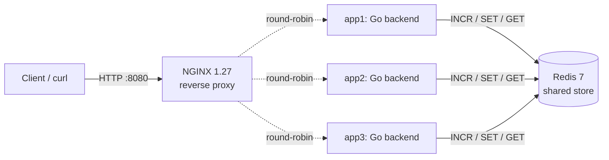

# Docker-based Multiserver System

> An NGINX reverse proxy fronting three identical Go backend replicas, all sharing a single
> Redis key-value store. Orchestrated by Docker Compose.

[](https://github.com/Kerem-Kurt/docker-based-multiserver-system/actions/workflows/ci.yml)

---

## Quick start

```bash
docker compose up --build -d                       # bring the stack up
curl -i http://localhost:8080/health               # smoke check
./scripts/test.sh                                  # full end-to-end smoke
docker compose down                                # tear down
```

Stack reaches healthy in ~30 seconds from a cold build. Once up:

| URL | What it does |
|-----|--------------|
| `http://localhost:8080/` | Increment local + global counters |
| `http://localhost:8080/store?key=K&value=V` | Write to the shared Redis store |
| `http://localhost:8080/get?key=K` | Read a key (returns `"value":null` if absent) |
| `http://localhost:8080/slow?seconds=N` | Sleep N seconds (silently clamped to 10) |
| `http://localhost:8080/health` | Liveness probe (no counter side-effects) |

---

## Architecture



Five services, orchestrated by a single `docker-compose.yml`:

| Service | Image | Role |
|---------|-------|------|
| `nginx` | `nginx:1.27-alpine` | Reverse proxy on host `:8080`. **The only service that publishes a host port.** Round-robin LB with fast failover (see [`nginx/default.conf`](nginx/default.conf)). |
| `app1`, `app2`, `app3` | `multiserver-app:local` (built once from [`app/`](app/)) | Three identical Go backend replicas. Differ only by the `SERVER_ID` env var, which they stamp on every response as `X-Server-Id`. |
| `redis` | `redis:7-alpine` | Shared key-value store. Backs the global counter (atomic `INCR`) and the `/store`/`/get` namespace. |

`depends_on: condition: service_healthy` chains startup: Redis must pass `redis-cli ping`, then the three backends start and pass their `wget /health` probe, and only then does NGINX begin accepting connections on `:8080`.

### Local vs shared state

- **`local_count`** is per-replica state — an in-process `atomic.Int64`. Replicas don't see each other's local counters, so `app1`'s `local_count` can be 12 while `app2`'s is 7 at the same moment.
- **`global_count`** is shared state — a Redis key incremented via atomic `INCR`. Every replica writes the same key; clients always see a monotonically rising value regardless of which replica handled the request.

### Tracing

NGINX generates a per-request `X-Request-Id` from `$request_id` and forwards it to the backend. The backend reads it, logs it (structured JSON via `log/slog`), and stamps it on the response. End-to-end tracing without external tooling.

---

## API reference

| Method | Path | Query params | Response body | Notes |
|--------|------|--------------|---------------|-------|
| `GET` | `/health` | — | `{"status":"ok","server_id":"appN"}` | Liveness; counters untouched |
| `GET` | `/` | — | `{"server_id":"appN","local_count":L,"global_count":G}` | **Only** endpoint that increments counters |
| `GET` | `/store` | `key`, `value` (both required) | `{"server_id":...,"key":...,"value":...}` | `400` if either is missing |
| `GET` | `/get` | `key` (required) | `{"server_id":...,"key":...,"value":...\|null}` | Missing key → `200` with `"value":null` (not `404`) |
| `GET` | `/slow` | `seconds` (int, required) | `{"server_id":"appN","slept":N}` | `seconds` is silently clamped to `[0, 10]`; `400` if missing or non-numeric |

Every response carries:

- `Content-Type: application/json`
- `X-Server-Id: appN` — which replica handled it (stamped by backend; NGINX passes it through unchanged)
- `X-Request-Id: <hex>` — generated by NGINX, echoed by the backend

---

## Pitfalls — and how this implementation avoids them

| Pitfall | Implementation choice |
|---------|----------------------|
| Lost counter updates under concurrency | `global_count` uses Redis `INCR` (single atomic round-trip). The stress test in [`app/race_test.go`](app/race_test.go) fires 200 concurrent `GET /` requests and asserts the final counter equals 200. |
| NGINX rewriting `X-Server-Id` | NGINX config has **no** `add_header` or `proxy_set_header X-Server-Id` directive. Backend stamps it; NGINX forwards unchanged. |
| Missing `Content-Type` | Middleware sets `Content-Type: application/json` on the response writer before any handler writes status or body. |
| Backend port leakage | Only `nginx` declares `ports:` (`8080:80`). All other services live on Compose's internal network. |
| Counter increments on the wrong endpoints | Only `GET /` mutates counters. `/health`, `/store`, `/get`, `/slow` are counter-free. |
| Three near-identical Docker images | One `build:` directive on `app1`; `app2` and `app3` reference `image: multiserver-app:local`. **One image, three replicas.** |
| Slow startup | Multi-stage Docker build (Go 1.26-alpine builder → Alpine 3.20 runtime, ~30 MB). Healthcheck-gated `depends_on` so each service starts only when its dependencies are actually serving. Cold-start time: ~30 seconds. |
| Backend failure breaking client requests | NGINX `proxy_next_upstream error timeout http_502 http_503 http_504; proxy_next_upstream_tries 3` transparently retries on the next replica. Empirically: 20 of 20 requests succeed with one backend stopped. |

---

## Testing

| Tier | Command | What it does |
|------|---------|--------------|
| Unit + race detector | `cd app && go test -race -v ./...` | 16 tests against `httptest` + [`miniredis/v2`](https://github.com/alicebob/miniredis). Includes a 200-concurrent stress test verifying counter atomicity under `-race`. |
| End-to-end smoke | `./scripts/test.sh` (stack up) | Hits every endpoint through NGINX and prints **observed values** alongside each PASS — readers see what the system actually did, not just pass/fail. |
| Experiments | `./scripts/experiments.sh` (stack up) | Captures load distribution, local vs global state, shared-store round-trip, backend failover, and concurrent slow-request distribution to text files. |
| CI | Push to `main` or open a PR | Runs `go vet`, `go test -race -v`, `docker compose build`, and the smoke test on GitHub Actions. See the badge at the top of this README. |

---

## Repository layout

```
.
├── app/                       Go backend service
│   ├── main.go                env wiring, Redis client init, server bootstrap
│   ├── server.go              Server struct, handlers, middleware, typed response structs
│   ├── server_test.go         16 unit tests (miniredis-backed)
│   ├── race_test.go           200-concurrent stress test for counter atomicity
│   ├── Dockerfile             multi-stage, alpine runtime, non-root user
│   ├── go.mod, go.sum
│   └── .dockerignore
├── nginx/
│   └── default.conf           upstream pool, round-robin, failover, request-id
├── scripts/
│   ├── test.sh                end-to-end smoke (used by CI)
│   └── experiments.sh         captures behavior experiments to text files
├── .github/workflows/ci.yml   CI pipeline
└── docker-compose.yml         stack definition (5 services)
```

---

## Tech stack

- **Backend:** Go (stdlib `net/http`), [`go-redis/v9`](https://github.com/redis/go-redis), `log/slog` for structured JSON logs
- **Proxy:** [NGINX](https://nginx.org) 1.27 (alpine)
- **Store:** [Redis](https://redis.io) 7 (alpine)
- **Runtime image:** Alpine 3.20, non-root `app` user, ~30 MB
- **Orchestration:** Docker Compose (single `docker-compose.yml`, no overrides)
- **Tests:** Go's `testing` + [`miniredis/v2`](https://github.com/alicebob/miniredis); pure bash for the smoke / experiment scripts
- **CI:** GitHub Actions

---

## Authors

Built by **Kerem Haktan Kurt** and **Kerem Bozkurt** as a university course project at Boğaziçi University.

## License

No license claimed.
