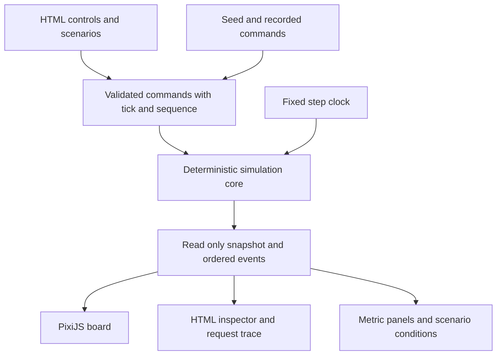
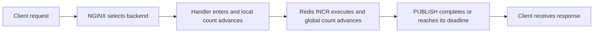

# Interactive simulator design

This design expands [issues 15–20](v1.0-simulator.md) into an operational sandbox for the existing NGINX, Go, and Redis system. The intended experience is **change a setting, predict the consequence, inspect what happened, and try again**. The user's stated priority on 4 November 2026 is changing settings and seeing the system react; city-like art is secondary.

Implementation is underway in `simulator/`; see its [delivery evidence](../../simulator/PROGRESS.md) for the current verified state. The product choices below are confirmed; numerical defaults and implementation details remain proposals to test. Numerical defaults are teaching assumptions, not measurements of the Docker stack. Repository behavior is grounded in source revision `3e48671`.

The implemented contract and verified limits now live in [MODEL.md](../../simulator/MODEL.md). This document preserves the design research and proposed delivery sequence; implementation details below are proposals where they differ from that contract.

## Confirmed product choices

Decided with the user on 4–5 November 2026:

- **Presentation:** a light isometric campus with building-like components, readable paths, and the important topology visible together. This fits the PixiJS 2D scope.
- **Model fidelity:** preserve important project behavior while using clearly labeled teaching values. The initial capacity sandbox omits the real root rate limiter.
- **Entry experience:** open directly into a working sandbox with modest healthy traffic and offer a short optional introduction. No mandatory tour or mode-selection screen.
- **Controls:** keep traffic controls visible; selecting a building opens its settings, with advanced options in a disclosure.
- **Comparison:** save one baseline and show a before/after summary using the same workload seed and observation window. This belongs in the first finished release.
- **First playable preview:** demonstrate scaling and backend failure/retry first, then add draining and the Redis bottleneck. All four experiments remain required for the finished milestone.

These settle the main product choices. Implementation details and measured limits remain adjustable during development. The user authorized completion of the simulator milestone on 5 November 2026.

**Presentation correction during implementation:** the user rejected the initial scrolling dashboard preview and asked for PGSimCity’s scene-first, professional feel. The simulation must fill the viewport as the background, with compact instruments and playback controls over it, contextual component inspectors, and an optional console for detailed charts and traces. This supersedes dashboard/card arrangements below. The original isometric geometry remains appropriate, but the site must feel like operating a simulation, not reading a product landing page. Recheck the relevant PGSimCity source during interaction and presentation passes; use its structural lessons without copying assets or code.

## What to adapt from PGSimCity

PGSimCity makes mechanisms inspectable through a spatial model, explanations, scenarios, and interventions. Its city is an educational model; the separate PGlite workbench is a different capability. The reviewed live version was `v0.58.1`, commit `ec4217c2534437be11d3dbe9797dbc9be7c354ef`. Its useful precedent here is the connection between a visible symptom, an underlying mechanism, and an action whose result can be checked. [PGSimCity architecture and boundaries](https://github.com/NikolayS/PGSimCity/blob/ec4217c2534437be11d3dbe9797dbc9be7c354ef/README.md).

Adopt four ideas: selecting one request, inspecting where work waits, making interventions reproducible, and linking explanations to model state. Do not import PostgreSQL internals, a first-person camera, or PGSimCity's feature inventory. Its renderer-independent model and separate timing layer are useful references, not code to transplant. [Model](https://github.com/NikolayS/PGSimCity/blob/ec4217c2534437be11d3dbe9797dbc9be7c354ef/src/sim/model.ts), [timebase](https://github.com/NikolayS/PGSimCity/blob/ec4217c2534437be11d3dbe9797dbc9be7c354ef/src/core/timebase.ts).

Sam Rose's interactive load-balancing explanation is especially close to this project's learning goals: introduce traffic, increase demand, add servers, and expose the latency cost of queues. Use that progression, while grounding our behavior in this repository rather than adopting its simplified server model unchanged. [Load Balancing](https://samwho.dev/load-balancing/).

## The first experience

The default light isometric campus should fit the important topology without camera navigation. Put traffic generation on the left, NGINX in the middle, three backend buildings beyond it, and the shared Redis primary on the right. Each component has a literal name, state, and a few useful numbers.

Traffic rate and slow-request share stay visible. Selecting a backend exposes capacity, stop, restart, and drain; selecting NGINX exposes retry behavior; selecting Redis exposes processing time, network delay, and availability. Keep less common settings such as admission limits inside an advanced disclosure. Native keyboard selection opens the same inspector as a canvas click. Component settings stay hidden until selected, but an active intervention remains visible in the campus state and event history.

```text
Educational model · Capacity sandbox       Pause  Step  Speed  Reset

Traffic           System board                         Inspector
Requests/s        Clients → NGINX → app1 ┐              Selected component
Slow requests %                   → app2 ├→ Redis       State and explanation
                                 → app3 ┘              Relevant controls

Offered/s   Completed/s   Failures   p95 latency   Waiting requests
                         Recent history

Experiment prompt                 Request trace and recent events
Save baseline   Compare           Before/after summary
```

Open directly into a running sandbox with modest healthy traffic. Offer a short optional introduction that the visitor can start, skip, or exit. Starting it uses a clearly identified guided configuration; exiting restores the saved sandbox state and playback setting. Its steps are paced by the visitor:

1. Follow one request while paused, watching its route and the two counters.
2. Run a modest stream and see the distribution across three replicas.
3. Stop one backend, inspect the failed attempt and retry, then restore it.
4. Raise demand and choose either scaling, draining, or the Redis bottleneck experiment.

Ninety seconds is a useful orientation target, not a countdown. Instructions advance when the relevant state is observed, not because a timer assumes an event happened. PGSimCity's state/narration tests are a useful precedent for checking that an explanation matches what the model actually did. [Scenario honesty tests](https://github.com/NikolayS/PGSimCity/blob/ec4217c2534437be11d3dbe9797dbc9be7c354ef/src/sim/honesty.test.ts).

## Visual direction

| Option | Role in this project | Decision |
| --- | --- | --- |
| Flat 2D topology | Useful for early engine/debug fixtures | Development aid; not the selected product presentation |
| Fixed isometric campus | Building-like components with readable routing, queues, and controls | Selected presentation for the playable product |
| Navigable 3D city | Makes spatial exploration a substantial feature | Outside the selected scope |

In the campus treatment, clients become an arrival plaza, NGINX a dispatch gate, backends identical service buildings, and Redis a shared state building. Keep literal technical labels and modest geometry so buildings never obscure the paths or queues. Roads indicate dependencies, not network distance. A queue lane means actual waiting work; an animated pulse must correspond to an actual model event. Decorative traffic must not masquerade as throughput.

Give failed and draining components different labels and icons. A draining backend closes admission while existing requests finish; a failed one loses its current process. Keep local counters on individual backends and the global counter at Redis. A read replica may be described in a model-boundary panel, but should not show animated replication until that behavior is actually implemented.

## Software architecture

Use Vite and TypeScript for a static workspace, PixiJS for the system board, and ordinary HTML for controls, inspectors, explanations, and metric tables. Start with a small DOM layer rather than adding an application framework solely to host a canvas. Add one only if the UI's state complexity justifies it.



The core owns everything that can change the outcome: scheduling, queues, routing, failures, counters, and observations. It imports no DOM or rendering library. A stateful engine with a small explicit API is sufficient; it need not clone the whole world after every event or use a general event-sourcing framework.

The renderer owns layout, hit areas, selection highlighting, and presentation interpolation. It never completes work because a sprite reached its destination. UI selection is separate from simulation state. Keyboard selection and canvas selection share the same component ID.

Proposed files, introduced only as their slices need them:

```text
simulator/
  src/model/       types, clock, scheduler, workload, proxy, backend, redis
  src/metrics/     rolling windows and derived statistics
  src/scenarios/   configurations, commands, observation predicates
  src/view/        topology layout and PixiJS presentation
  src/ui/          native controls, inspector, trace, accessibility
  test/           model contracts, scenario fixtures, browser checks
  MODEL.md        contracts, units, equations, assumptions, omissions
```

Begin on the main thread. A worker is an option after profiling, not a prerequisite; moving the same pure core later should not change the model contract.

## Three identities for every piece of work

Keep these separate in data structures and metrics:

| Entity | Meaning | Important fields |
| --- | --- | --- |
| Logical request | One client operation | ID, route, creation time, terminal outcome, end-to-end duration |
| Backend attempt | One NGINX dispatch for that request | Attempt ID, backend incarnation, connection/handler stage, retry reason |
| Redis operation | One command issued by an attempt | Operation ID, INCR or PUBLISH, queue/start/commit/ack times |

One logical request can have several attempts. One successful root attempt normally issues two Redis commands. These are not three ways to count the same thing.

The normal root path is:



Synthetic CPU and transport stages surround these semantic transitions. Each selected request gets a persistent text trace, including the reason and time for any wait or retry. The trace stays available after the packet marker disappears.

## Preserve the important repository behavior

The initial model should preserve these contracts and explicitly label the rest as an approximation. The [root and slow handlers](../../app/server.go), [proxy configuration](../../nginx/default.conf), [shutdown path](../../app/main.go), and [events handler](../../app/events.go) are the local references.

| Behavior | Consequence in the simulator |
| --- | --- |
| Only a valid `GET /` increments counters | `/slow`, health traffic, and other routes never advance them |
| Local increment precedes Redis INCR | Redis failure can advance local count without advancing global count |
| Root executes INCR then PUBLISH | Successful roots consume both command costs; publish failure can still yield HTTP 200 |
| PUBLISH has a 500 ms deadline | The live-event delivery outcome differs from the committed counter outcome |
| NGINX retries error, timeout, 502, 503, and 504 | The application's Redis-error HTTP 500 is not retried by this proxy configuration |
| Three proxy tries | The budget is three total attempts, not an initial attempt plus three retries |
| Passive upstream failure handling | Process health and NGINX's knowledge of it are different states |
| Process restart resets local memory | A new process incarnation starts its local counter at zero |
| `/slow` sleeps without Redis work | Slow-request percentage changes waiting and occupancy, not counter demand in the same way as roots |

NGINX retries only while the response has not already been sent to the client. Its read timeout concerns gaps between reads rather than a universal total-request duration. Keep those boundaries in the selected-request explanation. [NGINX proxy semantics](https://nginx.org/en/docs/http/ngx_http_proxy_module.html#proxy_next_upstream).

The first workload includes root and slow requests. Store/get, asynchronous replica reads, persistent durability, and long-lived WebSocket sessions can be later lessons. Include the existing root's PUBLISH cost now, without pretending to simulate delivery to every WebSocket subscriber.

## Model CPU work separately from waiting

A Go backend is not a single worker that stops processing everything while one request sleeps. Model a small synthetic CPU resource, a runnable queue, and independent in-flight request occupancy. A request waiting on Redis or a sleep timer releases CPU but remains in flight. This follows the distinction between a service goroutine and CPU execution; it does not emulate the Go scheduler. [Go HTTP serving](https://pkg.go.dev/net/http#Serve), [time.Sleep](https://pkg.go.dev/time#Sleep).

Define one standard request as one unit of CPU work. Proposed root work is 0.8 units before dependency work and 0.2 for the response. Proposed slow-request work is 0.05 units before sleep and 0.05 after. A backend capacity of 50 standard requests/s provides 50 work units per simulated second: 20 ms of CPU for a root and 2 ms for a slow request, independently of its sleep duration. Increasing capacity shortens CPU work; it does not accelerate a two-second sleep or Redis itself. All these costs are teaching parameters.

Give each backend a proposed in-flight cap of 128 requests, with a lower configurable cap in occupancy lessons. The current Go application does not implement that admission cap or a bounded worker pool, so label it a model abstraction. Rejection at the model cap is a distinct outcome, `model_admission_rejected`, not an invented HTTP 503 that accidentally triggers NGINX retries and passive ejection.

Queue indicators should say where requests wait: runnable CPU work, sleeping, or Redis. A single “busy” percentage would obscure the difference the simulator is supposed to teach.

## Redis has latency and capacity

Expose two separate controls: **command processing time** and **network round-trip delay**. Redis command work enters an ordered execution queue; transport delay occurs before and after that work. Network delay must not occupy the execution resource. Redis's own latency guide distinguishes command execution from communication and other sources of delay. [Redis latency](https://redis.io/docs/latest/operate/oss_and_stack/management/optimization/latency/).

For operation j, in simulated time:

```text
execution_start[j] = max(command_arrival[j], execution_finish[j-1])
execution_finish[j] = execution_start[j] + command_service_time[j]
```

An INCR changes shared state at execution completion, before its acknowledgment reaches the backend. A transport failure after commit does not undo it. Unsent client-side operations can be canceled; a command already accepted by Redis may still execute after its caller disconnects. Do not erase server work merely because its logical request has ended. PUBLISH is a second operation with its own outcome.

With only successful roots and no internal command retry, approximate Redis capacity is:

```text
root capacity = 1 / (INCR service seconds + PUBLISH service seconds)
```

That approximation excludes other workloads and deadline/transport effects. It is not `1 / network latency`: concurrent requests can overlap network waits. A failed PUBLISH path or a mixed workload changes command demand.

The Redis offline toggle initially means a synthetic service interruption with retained data. Reject new commands and fail queued/executing commands that have not committed; preserve committed changes and allow replies already traveling back to arrive. On recovery, never resurrect the commands that failed. An offline command at the exact commit timestamp wins under the ordering below, so that operation does not commit. Test INCR before/after commit, PUBLISH waiting, and recovery. This is not power loss, AOF loss, promotion, or disaster recovery. The real read replica is not extra INCR capacity and does not automatically become primary.

## Time and deterministic replay

Use fixed **20 ms outer steps**, with integer microsecond event times inside them. Each step drains events chronologically up to its boundary, including newly scheduled due events, before taking the boundary snapshot. Register boundary commands before processing that boundary's events. Use one priority queue consumed by `advanceTo(nextBoundary)`, not two timing engines. This preserves issue 15's fixed-step clock without rounding a 2 ms Redis operation up to 20 ms and imposing an artificial 50-operation/s ceiling.

Order scheduled events by `(time, phase priority, insertion sequence)`. Proposed tie semantics: operator commands first, service completions and deliveries second, deadline expirations third, new arrivals fourth, and metric sampling last. An acknowledgment delivered exactly at its acknowledgment deadline succeeds; execution finishing then does not suffice if return transport remains. A crash at the same time happens first. These are deliberate modeling choices and need tests. Stable time/sequence ordering has a well-established simulation precedent. [SimPy scheduling](https://simpy.readthedocs.io/en/latest/topical_guides/time_and_scheduling.html).

Start with regular arrivals and optional bounded seeded jitter. Use a versioned integer PRNG with independent workload and cosmetic randomness. Request type and service variation should derive from stable request IDs or independent streams so adding a retry does not alter all subsequent arrivals. Store model version, seed, initial configuration, and tick-indexed commands for repeatable experiments. Full checkpoints, time travel, and side-by-side replay can wait.

Pause stops model advancement. Single-step advances 20 ms; a selected-request “next event” action may be added later. Settings changed while paused are queued for the next boundary and shown as pending. Speed changes how quickly fixed steps are consumed, not service times or outcomes. The browser clock and frame rate never enter model transitions.

Rendering gets a bounded compute budget. If the simulation cannot keep up, reduce drawing or slow playback visibly; never discard modeled requests or secretly reduce offered load. Auto-pause when hidden, with a clear resume state. Browser animation callbacks vary with refresh rate and background visibility, which is why they cannot define model time. [Browser animation scheduling](https://developer.mozilla.org/en-US/docs/Web/API/Window/requestAnimationFrame), [fixed-step timing rationale](https://gafferongames.com/post/fix_your_timestep/).

## Give every control a precise consequence

| Control | Model effect | What should visibly change |
| --- | --- | --- |
| Offered requests/s | Changes future arrivals | Arrival density, waiting, throughput, latency |
| Slow requests % | Changes the type of newly created requests | Sleep occupancy increases; Redis work may decrease |
| Add replica | Creates a fresh process incarnation and routing target | New local counter at zero; redistributed attempts |
| Per-replica capacity | Changes CPU work units served per second | Runnable wait and CPU utilization, not sleep duration |
| Stop | Ends a process and its unfinished backend work | Failed attempts, proxy discovery, possible retries |
| Restart | Starts a new incarnation after a stated startup delay | Local counter resets; Redis counter persists |
| Drain | Stops new admission and waits for accepted work | Outstanding work falls before removal |
| Retry on or off | Changes dispatch after eligible failures | Attempts and final client outcomes diverge |
| Redis processing time | Changes service cost of newly started commands | Shared queue and maximum completion rate |
| Redis network delay | Changes transport time of newly sent commands | More outstanding work and response delay |
| Redis unavailable | Fails access while retaining modeled state | Root errors; `/slow` can still complete |
| Playback speed | Changes model time per wall-clock second | Same results at the same simulated time |

Specify changes during active work. A CPU-capacity update accounts for work already performed at the old rate, invalidates the old completion event, and reschedules remaining work at the new rate; the work cannot complete twice. Changing Redis service cost affects the next command, not a partially executed one. Network-delay changes affect future sends. Changing slow-request share does not reclassify requests already in flight. This makes controls predictable and replayable.

Keep the last replica removable through a deliberate stop command so total outage is explorable. “Remove replica” should default to drain, while “Stop now” is explicitly abrupt. Restarting a selected replica preserves selection of the logical component but displays the new process incarnation.

Define three distinct restart-of-experiment actions. **Reset experiment** restores its initial configuration and original seed, clears work/counters/history, and returns to paused time zero. **Run with these settings** uses the currently selected settings as a new time-zero configuration while preserving the seed, with empty queues and counters. **New workload seed** is a separate explicit action. Label the active seed and configuration changes. These actions make retry-on/off comparisons repeatable without introducing a full time-travel interface. A baseline replay uses the captured initial configuration and command schedule; it never quietly substitutes the latest slider values.

## Comparing one baseline

Keep one saved baseline in the browser session and compare it with one candidate run, sequentially on the same campus. This is part of the first finished release; it does not require two simultaneous canvases, general checkpoints, or a replay-file library.

1. **Save a complete baseline.** Capture model version, seed, initial configuration, bounded intervention schedule, traffic recipe, observation start/end, any warmup, sample counts, and results. If the declared window is incomplete, show recording progress and wait for it to finish; do not save a partial interval as a completed baseline.
2. **Prepare the candidate.** Start from the same clean initial state and apply the chosen configuration or intervention change. Preserve the offered workload, including request IDs, arrival times, request types, and sampled work costs. A seed alone is insufficient if configuration-dependent random consumption changes later arrivals. Preserve the common intervention schedule and identify any deliberate timing/action differences; reject invalid references to components that do not exist.
3. **Use the same observation window.** Run to the same simulated end time, with the same warmup and measurement boundaries. Pause and playback speed do not affect the comparison. If the user changes traffic rate, slow-request share, jitter, seed, model version, or observation window, require a new baseline or clearly mark the runs incomparable. Keep those controls visible and explain the mismatch rather than silently reusing old results.
4. **Show the result and its context.** Present baseline, candidate, and absolute changes for successful throughput, failures, latency, average/peak queues, pending requests/oldest age, CPU/Redis utilization, and counter increments during the window. Label latency cohorts and sample counts; show no-data explicitly. List all changed settings and interventions. Use percentage changes only when the baseline denominator is meaningful and nonzero.

Resetting the current experiment keeps the separately saved baseline; replacing or clearing it is explicit. The first version need not persist it across reloads. A controlled same-workload comparison helps explain a change, but one seeded experiment does not establish a production capacity claim. Test identical-run equality, one-setting changes, replay stability, incomplete windows, no completed samples, invalid intervention targets, and mismatched workload/version detection.

## Failure behavior worth teaching

**Backend loss.** Separate `process state` from `proxy eligibility`. With the repository's passive settings, NGINX learns about a failure from a real attempt, then excludes the target for ten seconds. Afterward a real request can test it again; do not draw an active probe that does not exist. Handle or document NGINX's single-server exception. A refused connection and a black-holed connection are separate cases; the latter can consume the configured two-second connection timeout. [NGINX upstream parameters](https://nginx.org/en/docs/http/ngx_http_upstream_module.html#server).

**Retry after commit.** A request can reach backend A, increment Redis, lose its connection before the response reaches the client, then succeed through backend B. The client sees one successful request; shared state may have advanced twice. A text trace makes this far easier to explain than a moving dot. The project's GET root has side effects, so the HTTP method alone does not make replay harmless.

**Redis command retries.** go-redis is another retry layer, independent of NGINX. Version 9.19.0 supplies default command retries. The initial model should explicitly omit internal command retries and disclose that it can understate ambiguity in this path; do not claim universal equality between handler entries and commits for the real application. Add operation-attempt modeling only if a later lesson needs it. [Pinned client defaults](https://github.com/redis/go-redis/blob/v9.19.0/options.go).

**Graceful drain.** The first control is a coordinated operator abstraction: withdraw from routing, finish admitted requests, and enforce the application's twelve-second shutdown budget. It is not an exact replay of Compose SIGTERM or Kubernetes endpoint propagation/preStop timing. Those paths have different windows. Contrast it with abrupt failure using the same workload and seed.

**Process identity.** Tag backend events with an incarnation ID. A delayed CPU completion from a stopped incarnation cannot resurrect work on its replacement. Already accepted Redis commands may still commit independently; the request trace must preserve that distinction.

**Redis failure.** Start with fail-fast command unavailability and retained shared state. Cover INCR failure and PUBLISH failure separately. A later timeout lesson must derive the root's connection/read/retry deadlines from pinned client options; do not borrow `/get`'s explicit two-second deadline for every Redis operation. Durability loss and replica promotion remain separate, currently unmodeled mechanisms.

## Synthetic defaults and four main experiments

Start with three replicas, 50 standard requests/s of CPU capacity each, root CPU work of one unit, INCR service time of 2 ms, PUBLISH service time of 1 ms, and a small separately configured transport delay. Set 128 in-flight requests per replica and a two-second slow-request delay. These are convenient, calculable teaching values.

At most 1–8 replicas, 0–500 offered requests/s, and 2,048 active logical requests are provisional supported bounds. The active-request limit is an explicit model admission outcome. Every overflow is counted; the renderer cannot silently throw requests away. Calibrate supported bounds through tests before promising them in the interface.

Bound server work separately: propose at most 2,048 accepted Redis operations, including commands whose clients have already finished. Reject new admissions before acceptance when that model resource is full; preserve already accepted operations. An INCR admission rejection is a labeled model-limit failure, while rejected PUBLISH follows the already-defined publish-failure path and does not undo a successful increment. Neither model-limit label should invent eligibility for a proxy retry. Bound recent request traces and event history, retain retired-process totals as aggregates, and discard consumed scheduler entries. Repeated capacity changes must replace or compact canceled service events. Keep the full command log only within an explicit recording limit; pause and explain when it is reached rather than silently losing reproducibility.

For an all-root workload before failures and limits interfere:

```text
backend CPU capacity ≈ replicas × 50 requests/s
shared Redis capacity ≈ 1 / (0.002 + 0.001) ≈ 333 roots/s
nominal system ceiling ≈ min(backend CPU capacity, shared Redis capacity)
```

These are service-demand bounds, not exact achieved throughput predictions. Routing imbalance, queuing, admission, transport, deadlines, and request mix all affect results.

| Experiment | Setup and intervention | Expected explanation | Completion evidence |
| --- | --- | --- | --- |
| Scaling under load | One replica, 120 roots/s; increase to three | CPU ceiling rises from 50 to 150/s; backlog can drain | Backlog slope changes, completions recover, new replicas receive work |
| Backend outage with retry | Three replicas, 60 roots/s; stop one, then compare retry off | Two survivors have spare capacity; retries can conceal a failed attempt | Trace shows failure and reroute; compare terminal outcomes under the same workload |
| Graceful drain | Moderate mixed traffic including long sleeps; drain one replica, then repeat with abrupt stop | Accepted work can finish while new traffic uses other replicas | No new admissions after withdrawal; admitted work finishes or reaches the stated deadline |
| Redis bottleneck | Eight replicas, 250 roots/s; change INCR/PUBLISH cost to 6/4 ms | CPU has 400/s nominal capacity, but Redis permits about 100 roots/s | Redis queue grows and throughput stops improving with more backend capacity |

Add a small **slow-request observation** within the drain/capacity lesson: 90 requests/s with 30% ten-second sleeps implies about 270 concurrent sleepers after warmup if the workload is admitted and stable. This is arrival rate × residence time. It illustrates occupancy without pretending sleeping requests consume CPU continuously. Queue caps and rejected arrivals change the calculation.

The default is a prominently labeled **Capacity sandbox** with the real root per-IP rate limiter omitted. Otherwise a one-client 120 requests/s lesson mostly demonstrates 429s. Document the actual repository's 10 requests/s, burst-20 behavior alongside the limitation. A future deployment-settings preset can add client identities and a tested limiter; it is not required to finish the initial capacity model.

Avoid timer-only success conditions such as “after ten seconds, show recovered.” Predicates should check a minimum observation window, sufficient samples, relevant utilization/queue direction, and stable healthy state. Tests need a failing counterexample for each predicate. A user's unplanned intervention should change or reset the lesson state instead of leaving a congratulatory message attached to the wrong system.

## Metrics that explain the outcome

Use a proposed five-second rolling window and keep sixty seconds of chart history. Label all time as simulated. Empty windows display “no completed samples,” and pause does not dilute rates using elapsed wall time.

| Metric | Definition |
| --- | --- |
| Offered rate | New logical arrivals divided by observed simulated window duration |
| Successful throughput | Logical successful responses completed in the window divided by duration |
| Total completion rate | Successful and failed terminal logical outcomes divided by duration |
| Failure fraction | Failed terminal outcomes divided by all terminal outcomes in the window |
| Mean and p95 latency | Arrival-to-terminal time for the named completion cohort; label success-only versus all outcomes |
| Pending requests | Logical requests without a terminal client outcome |
| Backend distribution | Attempt dispatches or handler entries, explicitly labeled; also expose successful completions |
| CPU utilization | Busy service time divided by available CPU-resource time over the window |
| Redis utilization | Redis command execution busy time divided by window duration |
| Queue depth | Current waiters by resource, with time-weighted average available for experiments |
| Counters | Local process handler entries and committed primary INCR operations, not inferred throughput |

Compute exact percentiles from bounded completed samples initially. For n sorted samples, use the documented nearest-rank index `ceil(0.95 × n) − 1`; test n = 0 and n = 1. Show sample counts. For start-up windows, use their actual observed duration. Retries do not add logical client completions.

Slow pending requests have not entered the completed-latency distribution yet. Always show pending count and oldest pending age beside latency; otherwise a failing system can misleadingly display a low p95 because only its fastest requests finish. Never add independent component p95s to manufacture end-to-end p95. A selected request can instead show its actual accumulated waits.

## Rendering without changing the model

Emit immutable snapshots and ordered semantic events: arrival, dispatch, handler entry, wait/start/finish, INCR commit, retry, response, failure, and component transition. A snapshot carries numerical state and IDs, never sprites, DOM objects, or camera coordinates. Freeze it in development tests; use an efficient read-only boundary in production.

Render between known model times. When a transition would be too fast to see, provide a slowed selected-request replay or a stationary recent-activity mark. Do not make a real-time packet appear to be processing after the metrics say it finished without labeling that presentation delay.

Use a provisional pool of 200 ordinary visible request markers, reserving visibility for a selected trace. Above that, display aggregate lane rates and a “traffic markers sampled” label. Count every model request regardless. Do not copy a visual optimization into the workload generator. PGSimCity's accuracy notes document why throughput distortion from presentation-oriented approximations is a risk worth testing. [Model accuracy](https://github.com/NikolayS/PGSimCity/blob/ec4217c2534437be11d3dbe9797dbc9be7c354ef/docs/MODEL-ACCURACY.md).

Update metric text a few times per second while drawing motion at the display rate. Pool sprites, keep hit testing on meaningful components, and avoid constantly rebuilding geometry. These fit PixiJS's documented performance guidance. [PixiJS performance](https://pixijs.com/8.x/guides/concepts/performance-tips).

## Accessibility and browser budgets

Native HTML must expose every meaningful control, component state, request trace, and scenario observation. PixiJS's accessibility overlays are opt-in helpers, not a replacement for this interface. Provide a keyboard component list, visible focus, explanatory text, and non-color state labels. Reduced motion replaces travel animation with static activity and stepwise traces. [PixiJS accessibility](https://pixijs.com/8.x/guides/components/accessibility), [reduced-motion preference](https://developer.mozilla.org/en-US/docs/Web/CSS/@media/prefers-reduced-motion).

On narrow screens, show controls and the selected component ahead of the system board. Users should not need to pan between distant buildings to diagnose a failure. Test all four scenarios without relying on animation, with keyboard navigation, zoom, a screen reader, and an actual phone in addition to emulation.

Proposed acceptance budgets: ordinary control feedback within 100 ms during playback; a 60 fps target on the named laptop and 30 fps on a named supported phone; a fifteen-minute maximum-supported-load run with bounded event queues, snapshots, histories, and graphical objects. These are targets for measurement. A missed budget should reduce presentation complexity or supported limits, never falsify model outcomes.

## Verification before visual polish

1. **Conservation:** offered logical requests equal pending plus successful plus failed terminal outcomes. Each has at most one terminal result; server work may remain after client termination and is counted separately.
2. **Atomic state:** committed INCR values are unique and ordered in the retained-state model. Local counts advance on handler entry and reset only with process incarnation. Retain retired-incarnation totals for audit assertions.
3. **Proxy contract:** check refused connections, timeouts, retry exhaustion, all-down and single-server cases, recovery after exclusion, and HTTP 500 without retry.
4. **Partial success:** check INCR commit followed by lost response, PUBLISH failure with successful root response, and counter differences after retries. State the omitted client-command retry layer in expected invariants.
5. **Scheduling:** test equal-time acknowledgment/deadline ordering, CPU-capacity changes without double completion, stale events after restart, pending Redis work after backend loss, Redis offline around commit, and drain deadlines. Ten isolated 2 ms commands with zero transport should finish at 2, 4, through 20 ms within one outer step.
6. **Determinism:** compare state/event hashes at identical simulated times across render rates, playback speeds, pauses, and repeated reset. Adding a view or changing visual sampling cannot change the workload.
7. **Scenarios:** each lesson passes only when its mechanism is present; deliberately broken routing/capacity configurations must fail its completion predicate.
8. **Comparison:** identical baseline/candidate equality, matched offered workload and windows, explicit configuration differences, incomplete/mismatched runs, pending work, and zero/no-data handling.
9. **UI and resources:** keyboard controls, selected-component removal, reset without silently deleting the saved baseline, hidden-tab pause, narrow screens, reduced motion, and bounded long-session storage.

Use the existing project unit/integration evidence to verify behavioral contracts. Do not claim numerical calibration from a few matching curves. The synthetic model can reproduce qualitative mechanisms while real k6 results remain a separate documented measurement.

## Delivery through the existing issues

| Issue | Concrete deliverable from this design |
| --- | --- |
| 15 | Pure core, event timing, root/slow behavior, queues, retries, counters, replay tests, initial MODEL.md |
| 16 | Read-only topology board, semantic states, selected request/component, bounded markers |
| 17 | Visible traffic controls, component settings with advanced disclosures, precise in-flight semantics, deterministic command recording |
| 18 | Defined metrics, one saved baseline and sequential before/after comparison, four state-driven experiments, reset and negative scenario tests |
| 19 | Complete nonvisual route, responsive/reduced-motion behavior, documented boundaries and manual audit |
| 20 | Tested static build, approved hosting route, exact-path browser checks, README entry point |

The first internal slice is one root request passing through one backend and Redis, with a text trace and correct counters. The first user-facing playable preview then brings together the light isometric campus, traffic/capacity controls, adding replicas, stopping/restarting a backend, retry behavior, and enough metrics/trace detail to demonstrate scaling and failure recovery. Add the drain and Redis bottleneck interactions next, then finish all four guided experiments, the saved-baseline comparison, accessibility verification, and publication. A preview does not close incomplete issue acceptance criteria. Keep issue 15's model work ahead of dependent views, but use small fixtures to validate each mechanism early rather than writing the entire engine without feedback.

Do not add free camera movement, player avatars, scoring economies, real Docker connections, browser-hosted Redis/Go runtimes, Sentinel, Kubernetes autoscaling, or real-service monitoring to this milestone. Side-by-side experiments, shareable replay files, replica consistency, and deployment-setting presets are useful later candidates. The first version succeeds when a visitor can explain why an intervention helped or failed.

## Source and research boundaries

Three subagent reviews covered PGSimCity, simulation semantics, and browser interaction. Primary references were PGSimCity's pinned source and live UI, this repository's Go/NGINX source, official NGINX/Redis/Go/PixiJS/browser documentation, SimPy's scheduling explanation, Glenn Fiedler's timing article, and Sam Rose's original load-balancing essay. No third-party simulator tests were run. The product choices at the top were confirmed with the user. Capacities, limits, exact layout, tie ordering, and implementation details remain proposals derived from that research.

For further exploration, the Raft project contrasts a guided visualization with a more interactive simulator. That supports offering both guided entry and a sandbox without making a second full interface mandatory. [Raft visualization references](https://raft.github.io/).
